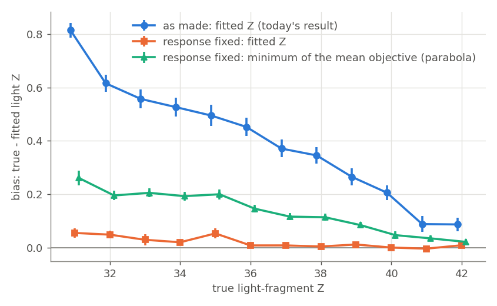
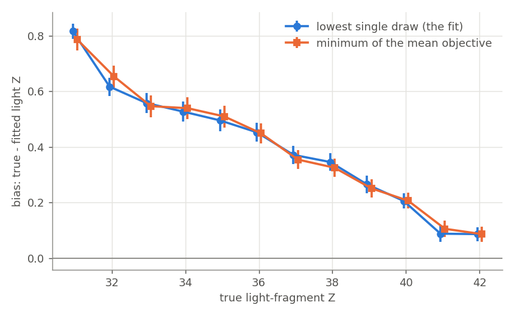
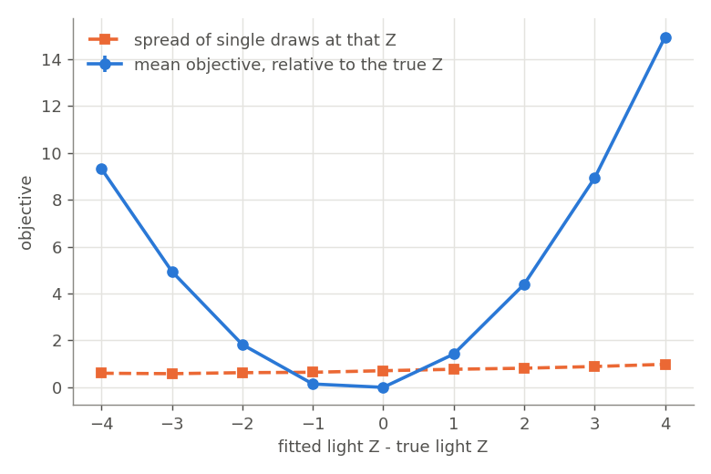
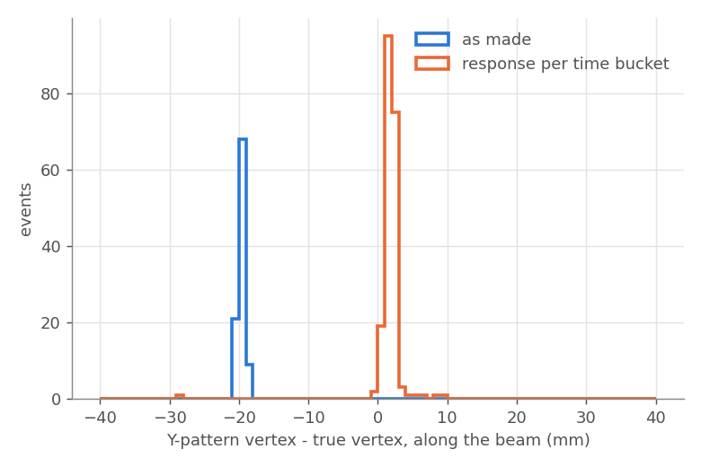
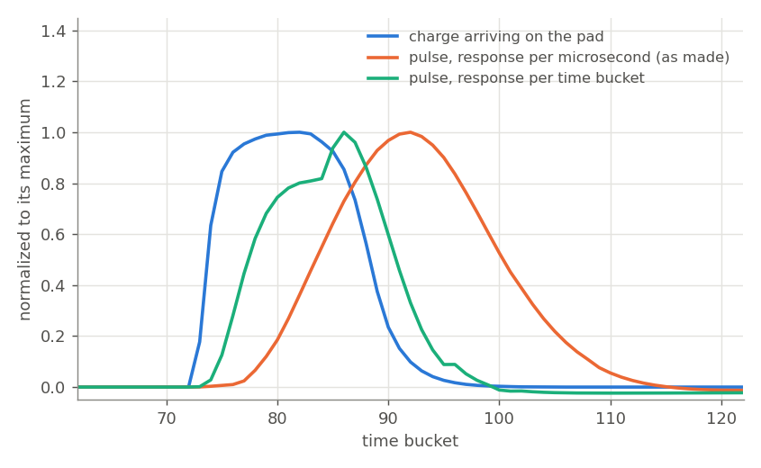

# Why the MC fission fit's fragment Z is biased

The Monte Carlo fission fit (`run_fit.C`, `AtMCFission`) of the 90° pseudo-data gives the light fragment a Z
that is on average 0.40 too low, more so for asymmetric splits (+0.82 at Z = 31, +0.08 at Z = 42). This
report finds where that comes from.

## Result

**The bias comes from a bug in how the pseudo-data is digitized, not from the fit.** `response.h`, the
measured electronics response used by `run_digi_fiss.C`, is a trace sampled once per time bucket (320 ns),
but it is looked up with the time in microseconds. So every simulated pulse in the pseudo-data is 3.1 times
too long and starts late. The pulse-shape analysis then deconvolves the traces with the true-width response,
which leaves the charge smeared and shifted by about 8 time buckets (20 mm of drift). The fit makes its own
hits straight from the simulated charge, so its picture of an event never matches the pseudo-data's, and the
closest match is at a lower light-fragment Z.

Re-digitizing the same 3000 simulated events with the response read per time bucket (`digi.respTB = 1`),
and fitting them with today's fit unchanged, brings the bias from +0.40 to +0.02:

| pseudo-data (3000 events) | bias | spread | exact Z | off by 3 or more | unfittable |
|---|---|---|---|---|---|
| as made | +0.401 ± 0.010 | 0.53 | 57% | 0.6% | 4.9% |
| response read per time bucket | +0.019 ± 0.003 | 0.18 | 96% | 2.2% | 0.1% |

Bias is the mean of true − fitted light Z over fits within 2, and spread their standard deviation;
fragments are matched to the true ones by azimuth (2% of the as-made events are dropped as ambiguous, none of
the fixed ones). "Unfittable" events are those where no simulation of the fit produced any charge to compare
(see [What remains](#what-remains)); the other columns are over the rest. `tune_report.py --truth --unfolded
--all` on the fixed fit gives the same: bias +0.019 ± 0.003, width 0.18, 2.3% off by 3 or more.

The bias per true light Z is gone at every Z (`fix_by_z.png`): it was +0.82 at Z = 31 and is now +0.05; at
Z = 36–42 it is 0.00–0.01. The resolution improves as much: 96% of events get exactly the right Z, against
57%.

A small part remains below one unit of Z. Where the mean objective has its minimum (a parabola through the
three Z around it) is still +0.13 ± 0.005 below the true light Z, with the same dependence on Z as the old
bias at a third of its size (+0.26 at Z = 31, +0.02 at Z = 42). Because the fit returns an integer Z, this
shows up as only +0.02 in the fitted Z. Its source is not found yet; the pseudo-data's pulse-shape analysis
and the Y-pattern are ruled out (below).

## Consequences

- Every fit of the `tune_data*` pseudo-data (the tuning study's step, diffusion-point, gain, search-length and
  energy-loss tables) was measured against mis-digitized pseudo-data. Their biases, widths and failure rates
  mostly measure this bug; the paired cost-versus-fidelity comparisons may also change on fixed data.
- The same `response.h` is in `macro/e12014/skyler/` and `macro/e12014/skyler/hpc/`, so the earlier
  validation studies made there have the same problem.
- Real data is not digitized, so this bug does not touch fits of real events. It does mean the fit has not
  yet been validated against pseudo-data whose electronics match the real detector's.
- `digi.respTB` defaults to the old behaviour. Pseudo-data meant to be realistic needs `digi.respTB = 1`.

## Evidence

### The bias is in the objective, not in the search

The fit's only free parameter is the fragment Z: the fragment directions and the vertex are fixed to the
Y-pattern found in the event (their sampling width is zero). So the 200 simulations the fit runs per event
are repeated draws of the objective at a few Z values, and averaging them per Z gives the event's mean
objective as a function of Z. On today's fit of the 3000 events (2801 with a valid fit and an unambiguous match):

- the Z with the lowest single draw (what the fit returns) has a bias of +0.401 ± 0.010;
- the Z with the lowest mean objective has +0.399 ± 0.011;
- the minimum of a parabola through the mean objective at the three Z around it, +0.401 ± 0.008.

They agree for every true Z as well.

The mean objective, relative to its value at the true Z, rises by only 0.14 one unit below the true light Z
and by 1.42 one unit above it: its minimum sits 0.4 below the truth. The noise of single draws (0.6–0.8) is
similar on both sides. So the search finds the minimum it is given; the minimum itself is in the wrong place.

This also explains why shorter searches show less bias. The first round draws Z around the symmetric split,
so a short search often never tries the Z below the true light Z where the objective is lowest: with 40
iterations in one round, 601 of 1408 events never sampled it, and the bias is +0.18. Once the search reaches
that Z the bias settles at +0.40.

The same holds for every other fit setting looked at (step 0.5 mm, 10 diffusion points, no gain
fluctuations, fixed diffusion patterns of 10 and 300 points): the lowest-draw and the mean-objective biases
agree within 0.06. The extra bias with 10 diffusion points (+0.65) is also a shift of the mean objective, not
noise.

### The pseudo-data's vertex is 20 mm off

The Y-pattern vertex found in the pseudo-data is 19.7 mm farther from the pad plane than the simulated vertex,
at every drift distance (median offset −19.6 to −19.8 mm in each 100 mm slice of vertex position, spread
1–6 mm). A shift that does not depend on drift distance is a timing offset in the pulses, not a drift
velocity error. Re-digitized with the response read per time bucket, the offset is +1.8 mm (spread 2.4 mm);
with hits made from the simulated charge, +1.7 mm.

### The response is stretched 3.1 times

`AtPulse` passes the response function the time since the charge arrived, in microseconds, as the framework's
`AtVectorResponse` expects (it divides by the bucket width). `Response::GetResponse` instead uses the time
directly as an index into the per-bucket trace, so bucket *i* of the measured response is used for a time of
*i* µs, i.e. 3.1 buckets. The measured response peaks 2 buckets after the charge; stretched, 6–9 buckets
after. One pad of one event: the pulse made as before peaks 10 buckets after the charge
arriving on the pad and is wider; read per time bucket it peaks 4 buckets after, as the measured response
does.

The expected leftover shift after deconvolving with the unstretched response is the difference of the
two responses' centroids, about 8 buckets, or 21 mm: what the vertex shows.

### Fixing it removes the bias

On the first 200 events, re-digitized locally three ways:

| pseudo-data (same 200 events) | bias | spread | exact Z | off by 3 or more | unfittable |
|---|---|---|---|---|---|
| as made | +0.46 ± 0.04 | 0.54 | 53% | 0.5% | 5% |
| response read per time bucket | +0.03 ± 0.02 | 0.22 | 92% | 4.5% | 0 |
| hits made as the fit makes them | +0.03 ± 0.01 | 0.20 | 96% | 1.5% | 0 |

Each is fit with today's fit; the first is the cluster's existing fit of these events, and a local
re-digitization as made (first 100 of them) reproduces it (paired change −0.01 ± 0.04). With the response
fixed the bias falls by 0.44 ± 0.04 (paired, same events; on all 3000 events by 0.38 ± 0.01). Making the
pseudo-data's hits exactly as the fit makes its own (nominal response, hits fit to the simulated charge, the
fit's threshold) gives the same result as only fixing the response (paired change +0.005 ± 0.022, and
−0.03 ± 0.02 for the parabola minimum): the deconvolution, its filter and the PSA threshold add no measurable
bias once the response is right. (The beam's deposits and the beam pads' separate pulse-shape analysis are
the same in both.)

### The simulation's fidelity is a smaller effect

Fitting the as-made data with the fit's simulation at the data's own fidelity (0.25 mm steps, 4000 diffusion
points; 461 events) lowers the bias by 0.12 ± 0.02 (paired, lowest draw; the parabola minimum moves by
0.075 ± 0.010). That is a quarter of the bias, from the fit's coarser simulation, measured on the as-made
data.

On the fixed data (first 500 events), the fit at the data's fidelity leaves the fitted Z unchanged (paired
change −0.004 ± 0.009; bias +0.027 ± 0.009 against +0.019 ± 0.009) and moves the minimum of the mean
objective by −0.055 ± 0.007, from +0.15 to +0.10. At ten times the cost (1080 against 111 CPU s per event)
it buys nothing in the fitted Z.

## What remains

- **A shift below one unit of Z.** With the response fixed, the minimum of the mean objective is still
  +0.13 below the true light Z, growing toward asymmetric splits. Giving the fit the true fragment directions
  and vertex in place of the Y-pattern's moves it by only −0.03 ± 0.02 (200 events, to +0.10 ± 0.02), and
  making the pseudo-data's hits as the fit makes them by −0.03 ± 0.02, so neither the pattern nor the
  pulse-shape analysis is its source. Two more candidates are ruled out: simulating the decay at 90° to the
  beam's direction, as the fit assumes, instead of to the z axis (about 1° off the beam; 200 new events,
  minimum +0.18 ± 0.03; the change took effect: the beam energy the fit infers from the fragments' angles
  scatters 15 MeV about the truth instead of 28 MeV), and removing the beam's energy deposits from the pseudo-data (100 events, paired
  change +0.02 ± 0.03). The fit's coarser simulation accounts for −0.055 ± 0.007 of it (above). About +0.1
  is left unexplained. Not tested: whether the objective itself prefers lower Z, for example through its
  weighting of each time bucket by the pseudo-data's own charge, or its single amplitude for both fragments.
  At the level of the fitted (integer) Z this residual is +0.02.
- **Events with the vertex near the window.** In today's fits 159 of 3000 events (5%) had no simulation that
  produced any charge to compare (every objective at its maximum value): 154 because the Y-pattern vertex,
  20 mm upstream of the truth because of the bug, lay outside the drift volume. `tune_report.py --all` and
  `dump_fit.C` count them as fits with an arbitrary Z, and they are most of the "5% off by 3 or more" (of the
  others, 0.6% are). With the response fixed only 2 events are unfittable, but 31% of events with the true
  vertex within 25 mm of the window are off by 3 or more (50 of 163), against 4% at 25–100 mm and 0.1–0.3%
  beyond 100 mm; 67 failures in all. In the few such events looked at, the mean objective is nearly the same
  at every Z. Why is not looked into.

- **Decay angles away from 90°.** The fit's large failure rate off 90° (70–86% off by 3 or more beyond 15°)
  was measured on the mis-digitized pseudo-data and has not been measured since the fix.

## Reproducing

Tools in this directory:

- `dump_landscape.C`: every sampled (Z, objective) point of every event of a set of fit or results files,
  with the true vertex, the pattern's directions and vertex, and the fit's beam energy.
- `landscape.py`: per-event mean objective by Z; bias of the lowest draw, of the mean-objective minimum and
  of the parabola minimum, per true Z, and the mean objective by distance from the true Z.
- `paired.py`: paired change of the bias between two fits of the same events.
- `vertex_check.C`: Y-pattern vertex and angles against the simulated vertex, per event.
- `truth_dirs.C`: true fragment directions and energies from sim files (extends `sim_truth.C`).
- `make_figures.py`: the figures.

Settings added (all default to the old behaviour):

| setting | meaning |
|---|---|
| `digi.respTB` | 1: read the measured response per time bucket (the fix) |
| `digi.respMeasured` | 0: nominal GET response, as the fit's pulse uses |
| `digi.simChargeHits` | 1: off-beam hits fit to the simulated charge, as the fit makes them |
| `digi.psaThreshold`, `digi.beamThreshold` | PSA thresholds (10 and 45) |
| `digi.beamCharge` | 0: drop the beam's energy deposits before digitizing |
| `fit.truePattern` | 1: the fit uses the true fragment directions and vertex instead of the Y-pattern's |

## Appendix

### Fits and data sets

| name in files | what it is |
|---|---|
| `tune_data90-fine` | the 3000-event 90° pseudo-data (0.25 mm steps, 4000 points), digitized as made |
| `tune_fid90-base`, `-base2` | today's fit of it, and a reseeded repeat |
| `tune_iter90-match` | the fit at the data's fidelity, first 10 chunks, as-made data |
| `tune_bias_det-asis`, `-resp`, `-qhits` | local re-digitizations of chunks 0–3 (0–1 for asis): as made, response per time bucket, hits as the fit makes them; each fit with today's fit |
| `tune_bias_det-truepat` | today's fit of `-resp` with the true directions and vertex |
| `tune_bias_det-nobeam` | `-resp` without the beam's deposits (chunks 1 and 3; the fits of 0 and 2 crashed) |
| `tune_bias_kin-beam` | 200 new events with the decay angle measured from the beam's direction, response per time bucket, today's fit |
| `tune_bias_resp-fix`, `-base`, `-match` | cluster: all 3000 events re-digitized with the response per time bucket; today's fit of them; the fit at the data's fidelity on the first 10 chunks |

### Paths

- Fetched cluster fits of the tuning study: `.claude/worktrees/fit-tune/macro/e12014/fissionStudies/data/remote/hpc-tune/`
- Local re-digitizations and fits: `.claude/worktrees/fit-bias/macro/e12014/fissionStudies/data/`
- Cluster data directory: `/home/faculty/aanthony/fission/adam/tune/data`
- Shared inputs used locally: `/home/adam/fair_install/tpcSharedInfo` (same content as the cluster's)
