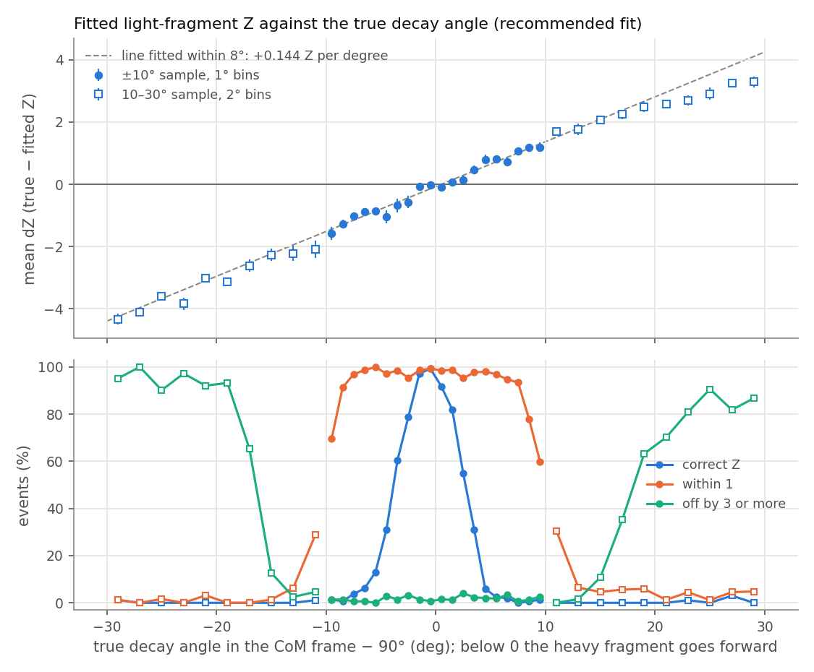

# Systematic Uncertainties of the Fitted Fragment Z: Results

**Status (2026-10-20).** Steps 1 and 2 of the [plan](PLAN.md) are done in part: the prerequisites and the baseline, and the energy-loss probes (B1, B2). The space-charge, kinematics, pad, electronics and gas probes are running. All results are from simulated events (pseudo-data). Decision log: [LOG.md](LOG.md).

**Notation.**
- **dZ** = true Z − fitted Z of the light fragment. A positive dZ means the fit gives the light fragment too low a Z.
- **θ_CM** is the decay angle in the center-of-mass frame, the angle of the heavy fragment's momentum to the beam. Below 90° the heavy fragment goes forward and the light fragment backward.
- **pp** is percentage points.
- **Δ** (a change) is a variation minus the baseline, both fitted with the recommended settings, averaged over the events of both, event by event.

## Summary

- **The decay angle shifts the fitted Z almost linearly: dZ changes by +0.144 ± 0.007 Z per degree of θ_CM − 90°.** The slope is fitted to events within 8° of 90° and is about the same for every true Z. The straight line holds out to about 20° from 90°, where the mean dZ reaches ±3. When the heavy fragment goes forward (θ_CM < 90°), the fit gives the light fragment too high a Z; when it goes backward, too low.
- **The fitted Z is correct only within a few degrees of 90°, and the two sides of 90° differ.** Of the events between 88° and 90°, 98% have the correct Z; between 90° and 92°, 86%. Two to four degrees away, the fraction is 70% below 90° and 42% above it. Up to 8° away, 94% or more of the fits are within one Z. Beyond 15° most are off by 3 or more.
- **Binning in the unsigned angle |θ_CM − 90°| hides the shift.** In such bins the shifts on the two sides of 90° cancel, so the bias stays below 0.16 Z while the spread grows to 1.3 Z. Every systematic must therefore be reported against the signed angle.
- **Vertices near the window give most of the fits off by 3 or more.** Within 25 mm of the window, 20% of the fits are off by 3 or more, mostly with the two fragments' Z exchanged; 25–50 mm from it, 10%. Beyond 50 mm, 2% or less. 45 of the sample's 52 fits off by 3 or more have their vertex within 50 mm of the window.
- **The recommended settings match the reference settings on this sample, except just above 90°.** Compared with the reference fit on the same events, the recommended fit changes the fraction with the correct Z by −0.4 ± 0.4 pp, the bias by +0.015 ± 0.005 Z and the fraction off by 3 or more by +0.1 ± 0.1 pp. It costs 10.4 CPU-s per event against 109.6. The one exception: between 90° and 92° it has 5.8 ± 1.5 pp fewer fits with the correct Z.
- **The fit's own random scatter is small.** Fitting the same events with another seed changes the fraction with the correct Z by +0.4 ± 0.5 pp and the bias by −0.001 ± 0.005 Z.
- **The mass unit has no effect (probe C4 of the plan).** Simulating at 939.0 instead of 931.5 MeV per mass unit changes the fraction with the correct Z by +0.8 ± 0.7 pp, the bias by +0.008 ± 0.008 Z and the folding angle (between the two fragment tracks) by +0.001 ± 0.001°. The simulation starts from kinetic energies, so scaling every mass leaves every lab kinetic energy unchanged to 10⁻⁵, and the energy-loss tables depend only on kinetic energy.

- **The difference between the LISE and SRIM stopping powers shifts the fitted Z by about 0.6 Z, more for asymmetric splits.** Pseudo-data made with SRIM and fitted with LISE give a bias +0.60 ± 0.01 Z higher than LISE pseudo-data fitted with LISE; LISE pseudo-data fitted with SRIM give −0.55 ± 0.01 Z. The shift is the same at every decay angle within 10° of 90°, and for the light fragment's true Z it falls from about 1 Z at Z = 31–32 to 0.15 Z at Z = 42. SRIM pseudo-data fitted with SRIM have the baseline's bias (+0.007 ± 0.009 Z).
- **A common scale on every fragment's stopping power hardly matters.** dE/dx × 0.95 to × 1.05 changes the bias by at most 0.014 Z (+0.0025 ± 0.0008 Z per percent). The fit's amplitude absorbs the scale; only vertices within 200 mm of the window, whose fragments stop in the gas, move by ±0.05 Z for ±5%.



## The baseline

### Samples

All samples use the LISE energy-loss tables and the measured electronics response, and are simulated in more detail than any fit: 0.25 mm steps and 4000 sampling points per charge line. In every event the light fragment's Z is drawn uniformly from 31 to 42 (heavy fragment 54 to 43), with A = round(204 · Z / 85) and no spread in mass. The vertex depth, its distance from the window, is uniform over 0–700 mm, from the window to 300 mm before the pad plane.

| sample | study file | events | θ_CM | used for |
|---|---|---|---|---|
| ±10° (`base`) | `syst_base.ini` | 3000 | uniform over 80–100° | every variation of the study is compared with it |
| 10–30° (`wide_lo`, `wide_hi`) | `syst_base.ini` | 750 + 750 | uniform over 60–80° and 100–120° | fitted once, never varied |
| C4 (`mu931`, `mu939`) | `syst_c4.ini` | 1000 at each mass unit | uniform over 80–100° | the mass unit only |

Each Z from 31 to 42 has 231–276 events in the ±10° sample. Every event in every sample has a Y-pattern, the Y-shaped vertex of beam and fragment tracks that the fit starts from. The simulation redraws an event when a fragment's track ends within 50 mm of the beam axis; this happened once in the 5500 events, in the 10–30° sample.

### Fits

| fit | settings | CPU-s / event |
|---|---|---|
| `rec` | recommended: 2 mm step, a fixed pattern of 100 sampling points, longitudinal diffusion over ±2σ, no gain fluctuations, 3 rounds of 40 iterations | 10.4 |
| `rec2` | `rec` with another seed | 10.5 |
| `ref` | reference: 1 mm step, 1000 random sampling points, ±3σ, gain fluctuations, 2 rounds of 100 iterations | 109.6 |

Every fit uses 4 threads. The 10–30° and C4 samples are fitted with `rec` only.

### What is measured

Computed by `syst_report.py` over every event of a fit:

- **dZ** compares the fitted Z with the true Z of the same fragment. Fitted and true fragments are matched by azimuth, as in the tuning study. No event in any sample has fragments too close in azimuth to match.
- **Correct Z**: dZ = 0. **Within 1**: |dZ| ≤ 1. **Off by 3 or more**: |dZ| ≥ 3. **Bias** and **spread**: the mean and the standard deviation of dZ over the fits with |dZ| ≤ 2. **Mean dZ** (in the figure and the slope) is taken over every fit.
- **Unfittable**: no simulation of the fit put charge on the pads with a data hit. These events are counted, then left out of every other measure. The ±10° sample has 4 of them in 3000 events, all within 100 mm of the window.
- **Folding angle**: the angle between the two fragment directions of the Y-pattern, which the fit uses to infer the beam velocity.
- **Changes between two fits** are computed event by event and given with one standard error. This works for two fits of the same simulated events, and also for the C4 samples: their two simulations use the same seeds, and all 1000 events have the same Z split and fragment directions in both.

## Results

### Decay angle

The recommended fit on the ±10° sample, in bins of θ_CM − 90°:

| θ_CM − 90° | events | correct Z | within 1 | off by ≥ 3 | bias (Z) | spread (Z) |
|---|---|---|---|---|---|---|
| −10 to −8° | 286 | 1.0% | 80.1% | 1.4% | −1.18 | 0.41 |
| −8 to −6° | 309 | 4.9% | 97.7% | 0.6% | −0.94 | 0.34 |
| −6 to −4° | 292 | 21.6% | 98.6% | 1.4% | −0.77 | 0.43 |
| −4 to −2° | 291 | 70.1% | 96.9% | 2.4% | −0.28 | 0.47 |
| −2 to 0° | 282 | 98.2% | 98.9% | 1.1% | −0.01 | 0.08 |
| 0 to +2° | 295 | 86.4% | 98.6% | 1.4% | +0.12 | 0.33 |
| +2 to +4° | 320 | 41.9% | 96.6% | 3.1% | +0.55 | 0.52 |
| +4 to +6° | 315 | 4.1% | 97.5% | 1.9% | +0.96 | 0.25 |
| +6 to +8° | 304 | 1.0% | 94.1% | 2.0% | +1.03 | 0.22 |
| +8 to +10° | 306 | 1.0% | 69.0% | 2.0% | +1.27 | 0.51 |

The statistical errors are 1–3 pp on the fractions and 0.01–0.03 Z on the bias.

- **The shift is close to a straight line.** A straight line fitted to dZ of every event within 8° of 90° has a slope of +0.144 ± 0.007 Z per degree and a value of −0.07 Z at 90°. The fitted Z is an integer, so the fraction with the correct Z stays high until the shift approaches half a unit, then falls steeply. The line crosses zero at about +0.5°, yet the fit is most often correct below 90° (next bullet): the mean dZ includes the fits off by 3 or more, so the line does not locate the angle of the best fits.
- **The fit is most often correct just below 90°, not at 90°.** In 1° bins, 97–99% of the fits between 88° and 90° have the correct Z, against 92% between 90° and 91° and 82% between 91° and 92°.
- **Why the angle shifts Z.** The fit takes the fragment directions from the data and derives the fragment energies from them, assuming a 90° decay (`AtMCFission`, `thCM`). When the light fragment actually goes backward in the center-of-mass frame (θ_CM < 90°), its lab energy is lower than the fit assumes, and its track is shorter. The fit makes up for the shorter track with a higher Z, which loses energy faster. The heavy fragment, going forward, has more energy than the fit assumes, so the fit gives it a lower Z; since the two Z add up to 85, both effects raise the light fragment's Z. When the light fragment goes forward, the reverse happens.
- **The slope is about the same for every true Z:**

  | true light-fragment Z | 31 | 32 | 33 | 34 | 35 | 36 | 37 | 38 | 39 | 40 | 41 | 42 |
  |---|---|---|---|---|---|---|---|---|---|---|---|---|
  | slope (Z per degree) | 0.20 | 0.12 | 0.15 | 0.09 | 0.16 | 0.12 | 0.15 | 0.15 | 0.14 | 0.15 | 0.16 | 0.16 |
  | error | 0.04 | 0.04 | 0.01 | 0.03 | 0.03 | 0.02 | 0.01 | 0.01 | 0.02 | 0.01 | 0.01 | 0.01 |
  | correct Z within 2° of 90° | 78% | 94% | 88% | 94% | 90% | 94% | 89% | 89% | 98% | 98% | 98% | 96% |

  Each true Z has 37–67 events within 2° of 90°, so the fractions in the last row carry errors of 2–7 pp. The asymmetric splits (light-fragment Z 31–38) have the correct Z slightly less often than the near-symmetric ones (39–42).

### 10–30° from 90°

The recommended fit on the 10–30° sample:

| θ_CM − 90° | events | correct Z | within 1 | off by ≥ 3 | mean dZ |
|---|---|---|---|---|---|
| −30 to −25° | 197 | 0.5% | 1.0% | 95.9% | −4.12 ± 0.08 |
| −25 to −20° | 166 | 0.0% | 1.2% | 94.6% | −3.48 ± 0.10 |
| −20 to −15° | 181 | 0.0% | 0.6% | 68.5% | −2.73 ± 0.10 |
| −15 to −10° | 206 | 0.5% | 14.6% | 4.4% | −2.20 ± 0.16 |
| +10 to +15° | 181 | 0.0% | 17.7% | 2.2% | +1.78 ± 0.07 |
| +15 to +20° | 167 | 0.0% | 4.8% | 43.1% | +2.32 ± 0.09 |
| +20 to +25° | 212 | 0.5% | 2.4% | 79.0% | +2.74 ± 0.09 |
| +25 to +30° | 190 | 1.1% | 4.2% | 85.8% | +3.15 ± 0.12 |

- **10–15° from 90°, about 80% of the fits are off by exactly 2**, with the sign the straight line predicts.
- **Beyond 15° most fits are off by 3 or more.**
- **The mean dZ follows the straight line out to about 20° on both sides.** Beyond 20° it grows more slowly above 90° than below (+3.15 against −4.12 at 25–30°).

### Vertex depth

The recommended fit on the ±10° sample, by the true vertex depth:

| vertex depth (mm) | events | correct Z | within 1 | off by ≥ 3 | of these, Z exchanged | correct Z within 2° of 90° | mean folding angle |
|---|---|---|---|---|---|---|---|
| 0–25 | 179 | 29% | 73% | 20.1% | 25 of 36 | 82% (33 events) | 27.1° (0–100 mm) |
| 25–50 | 87 | 25% | 84% | 10.3% | 2 of 9 | 88% (16) | |
| 50–100 | 199 | 27% | 92% | 1.5% | 1 of 3 | 84% (44) | |
| 100–200 | 425 | 30% | 93% | 0.7% | 2 of 3 | 89% (72) | 28.3° |
| 200–300 | 424 | 32% | 92% | 0% | — | 95% (74) | 29.5° |
| 300–400 | 441 | 31% | 94% | 0% | — | 94% (96) | 31.1° |
| 400–500 | 425 | 32% | 94% | 0% | — | 96% (79) | 32.9° |
| 500–600 | 432 | 35% | 97% | 0% | — | 93% (84) | 35.4° |
| 600–700 | 384 | 41% | 98% | 0.3% | 0 of 1 | 96% (78) | 38.4° |

- **Near the window the fit often gives the light fragment the heavy fragment's Z**, which happens rarely elsewhere (3 events beyond 50 mm). The cause has not been investigated. Requiring the vertex to be at least 50 mm from the window would remove 45 of the 52 fits off by 3 or more, and 9% of the events.
- **Deeper vertices do a little better.** The fraction within one Z rises from 92% at 100–200 mm to 98% at 600–700 mm. The folding angle grows with depth because the beam slows down.

### Recommended against reference settings

The recommended fit minus the reference fit, event by event:

| θ_CM − 90° | Δ correct Z (pp) | Δ bias (Z) | Δ off by ≥ 3 (pp) |
|---|---|---|---|
| all | −0.4 ± 0.4 | +0.015 ± 0.005 | +0.1 ± 0.1 |
| −2 to 0° | +0.0 ± 0.5 | +0.000 ± 0.005 | +0.4 ± 0.4 |
| 0 to +2° | −5.8 ± 1.5 | +0.059 ± 0.015 | +0.0 ± 0.0 |
| +2 to +4° | −2.5 ± 2.1 | +0.016 ± 0.024 | +0.0 ± 0.4 |
| other 2° bins | −0.3 to +2.1, each within 1.2 s.e. of 0 | −0.011 to +0.030 | −0.7 to +0.3 |

- **Over the whole ±10° sample the two settings agree** within the tuning study's limits: ±2 pp for the correct Z, ±0.05 Z for the bias, ±1 pp for the fraction off by 3 or more, and ±0.1 Z for the bias of every true Z. The largest change in the bias for a single true Z is +0.047 ± 0.024 Z, at Z = 31.
- **Between 90° and 92° the reference fit is better.** There 14% of the recommended fits are already one Z away, so many events lie near the boundary between two Z. The recommended search simulates each Z fewer times (3 rounds of 40 iterations against 2 of 100), so a neighboring Z reaches the lowest χ² more often and tips more of these events over. The tuning study's events, all at exactly 90°, show no such loss.

**Another seed.** The recommended fit with another seed changes the fraction with the correct Z by +0.4 ± 0.5 pp, the bias by −0.001 ± 0.005 Z and the fraction off by 3 or more by −0.1 ± 0.2 pp. In each 2° bin of θ_CM − 90°, the changes in the fraction with the correct Z are at most 2.7 pp and those in the bias at most 0.03 Z, each within 1.6 standard errors of zero. The folding angle is the same in both fits, since it comes from the data.

### Mass unit (C4)

The C4 events simulated at 939.0 MeV per mass unit (the simulation's old value) minus the same events simulated at 931.5 (the fit's value), both fitted with the recommended settings, event by event:

| | Δ correct Z (pp) | Δ bias (Z) | Δ off by ≥ 3 (pp) | Δ folding angle (deg) |
|---|---|---|---|---|
| all 1000 events | +0.8 ± 0.7 | +0.008 ± 0.008 | −0.4 ± 0.3 | +0.001 ± 0.001 |
| per 2° bin of \|θ_CM − 90°\| | −0.9 to +2.0 | −0.005 to +0.019 | −1.2 to +1.4 | −0.000 to +0.002 |

- **The tracks hardly change.** The lab kinetic energy of a fragment is the same at either mass unit to 10⁻⁵ (the same event gives 1141.86 MeV in both). The simulation derives the beam velocity from the beam's kinetic energy at the window, and the fragment velocities in the center-of-mass frame from the total kinetic energy, so both scale as 1/√(mass unit). Every lab velocity therefore scales the same way, and ½mv² does not change. The energy-loss tables depend only on the kinetic energy.
- **Pseudo-data simulated at 939.0**, such as the tuning study's, are therefore unaffected by the old mass unit.

## Systematic shifts

Each variation simulates the baseline's 3000 events again with one input to the model changed and the same seeds, or digitizes the baseline's simulation again, and fits it with the recommended settings and the baseline's model of the detector and reaction (with LISE stopping powers). Where an input can also be changed in the fit, a second fit with the changed input in both separates the effect of the mismatch from that of the changed input itself.

The changes are taken event by event against the baseline's fit (`rec`). A changed simulation keeps 98.9–99.6% of the events identical at the start (the same Z split, decay angle and directions; the rest differ because a changed track redraws an event or shifts the random draws), so the pairing holds for nearly every event. Δ bias is the change of the mean dZ over the fits with |dZ| ≤ 2 in both.

### Energy loss (B1, B2)

The fit gets Z from the shape of each fragment's charge along its track (its Bragg curve), with one amplitude shared by both fragments, so it depends on how the stopping power changes with the fragment's energy and Z. Neither model is preferred: the difference between them is the systematic. The baseline uses LISE: the ATIMA 1.2 column of the LISE files (`LISE` in the code), which ATIMA itself (CATIMA) reproduces to 0.1% in dE/dx. SRIM's tables differ from LISE's by up to 13% in dE/dx, in a way that depends on Z and energy, and were made for a 2.6% lower gas density (1.752 × 10⁻⁴ against 1.7985 × 10⁻⁴ g/cm³). The beam always uses LISE.

| variation | Δ correct (pp) | Δ bias (Z) | Δ off ≥ 3 (pp) |
|---|---|---|---|
| SRIM data, LISE fit | −3.0 ± 1.1 | +0.602 ± 0.011 | +1.2 ± 0.3 |
| LISE data, SRIM fit | +4.5 ± 1.1 | −0.553 ± 0.010 | +0.2 ± 0.1 |
| SRIM data, SRIM fit | +5.1 ± 0.7 | +0.007 ± 0.009 | −0.2 ± 0.2 |
| LISE dE/dx × 0.95 | +1.1 ± 0.5 | −0.014 ± 0.006 | +0.2 ± 0.2 |
| LISE dE/dx × 0.98 | −0.1 ± 0.4 | −0.001 ± 0.005 | +0.1 ± 0.2 |
| LISE dE/dx × 1.02 | −0.2 ± 0.4 | +0.004 ± 0.005 | −0.1 ± 0.2 |
| LISE dE/dx × 1.05 | −0.4 ± 0.5 | +0.013 ± 0.006 | −0.2 ± 0.2 |

The folding angle changes by at most 0.003°: it comes from the Y-pattern, which the stopping power does not move.

- **The model mismatch shifts Z by the same amount at every decay angle.** In each 2° band of θ_CM − 90° within 10° of 90°, SRIM data fitted with LISE shift by +0.43 to +0.75 Z, and LISE data fitted with SRIM by −0.36 to −0.79 Z. The mismatch alone, SRIM data fitted with LISE against the same data fitted with SRIM, is +0.596 ± 0.010 Z. The Δ correct depends on the angle only because the baseline's own bias does (see [Decay angle](#decay-angle)): where the baseline is too low, a positive shift brings fits to the correct Z.
- **The shift depends on the split.** Within 4° of 90°:

  | true light-fragment Z | 31 | 32 | 33 | 34 | 35 | 36 | 37 | 38 | 39 | 40 | 41 | 42 |
  |---|---|---|---|---|---|---|---|---|---|---|---|---|
  | SRIM data, LISE fit | +0.91 | +1.23 | +0.73 | +0.69 | +0.66 | +0.67 | +0.44 | +0.43 | +0.36 | +0.29 | +0.84 | +0.15 |
  | LISE data, SRIM fit | −0.98 | −0.89 | −0.69 | −0.64 | −0.61 | −0.61 | −0.59 | −0.37 | −0.40 | −0.58 | −0.36 | −0.13 |

  Errors 0.04–0.06 Z. In a near-symmetric split both fragments have similar Z and velocity, so a change of model changes both Bragg curves alike, and the fit, which keeps the two Z adding up to 85, moves little. In an asymmetric split the two fragments sample different parts of the stopping-power curves.
- **A scale common to both fragments is absorbed by the amplitude.** A uniform change of dE/dx changes the size of every charge curve, which the shared amplitude takes up, and the length of each track. The length is seen only where a fragment stops in the gas: for vertices within 200 mm of the window, dE/dx × 0.95 and × 1.05 shift the bias by −0.05 ± 0.02 and +0.05 ± 0.02 Z; for deeper vertices, at most 0.04 Z. A shift of the scale between the models is therefore not a concern; the difference in shape is.

## Code and tools (branch `fit-syst`)

- **New settings.**
  - `sim.decayAngleMin` and `sim.decayAngleMax` draw θ_CM uniformly between two angles.
  - `sim.massUnit` (default 931.5, the fit's value).
  - `sim.elossScale` multiplies every fragment's dE/dx (LISE tables only).

  See the [settings reference](../MANUAL.md#settings-reference).
- **`AtELossTable::SetDensity`** no longer crashes on a table without range variance, which includes every LISE table. Unit test `SetDensityWithoutRangeVariance`.
- **`dump_fit.C`** also writes the true vertex depth, the folding angle and vertex depth of the Y-pattern, and the fitted beam energy. Events without a fit are written with their true angle and depth.
- **`syst_report.py`**: the measures above, grouped by true Z, angle band, side of 90°, depth band, or true Z within an angle band, and the changes against a chosen base fit.
- **`syst_study/make_figures.py`**: the figure. **`truth_*.csv`**: `sim_truth.C`'s output for every simulation.
- **The local copy of the beam's LISE table (`83_200.txt`)** was the ¹⁴²Pr table and has been replaced with the cluster's ²⁰⁰Bi table (prerequisite P6 of the plan). Every other shared input agrees with the cluster's copy.

## Appendix: machines and paths

- Cluster checkout `/home/faculty/aanthony/fission/adam/syst/code` (remote `hpc-syst` in `remotes.ini`). Data directory `/home/faculty/aanthony/fission/adam/syst/data`. `throttle.sh` and its log in `/home/faculty/aanthony/fission/adam/syst/`; truth tables in `.../syst/truth/`.
- Fetched results in `fissionStudies/data/remote/hpc-syst/`.
- The tables come from:

  ```
  ./syst_report.py hpc-syst:syst_base:rec@syst_study/truth_syst_base-base.csv \
     hpc-syst:syst_base:rec2@syst_study/truth_syst_base-base.csv \
     hpc-syst:syst_base:ref@syst_study/truth_syst_base-base.csv \
     --base rec --by all --by side --by depth --by z
  ./syst_report.py hpc-syst:syst_base:wide_lo@syst_study/truth_syst_base-wide_lo.csv \
     hpc-syst:syst_base:wide_hi@syst_study/truth_syst_base-wide_hi.csv \
     --by side --angle-edges 10 15 20 25 30
  ./syst_report.py hpc-syst:syst_c4:mu931@syst_study/truth_syst_c4-mu931.csv \
     hpc-syst:syst_c4:mu939@syst_study/truth_syst_c4-mu939.csv \
     --base mu931 --paired --by all --by angle
  ```
