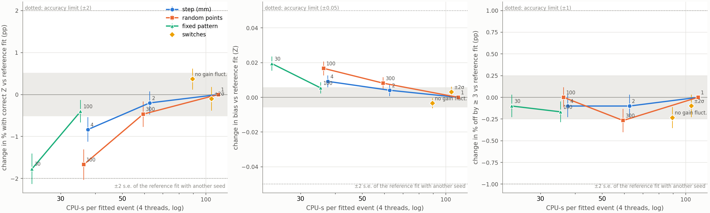
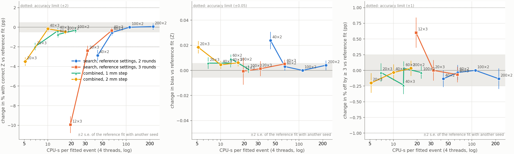
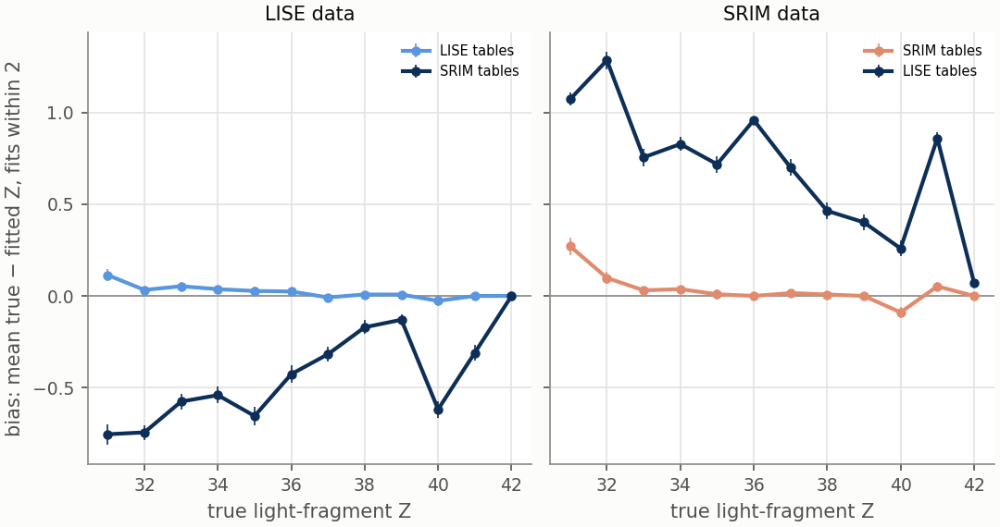

# MC Fit Tuning Study: Fit Accuracy Against CPU Cost

**Status (2026-10-19 19:00).** Complete. All results are from simulated events (pseudo-data) digitized with the corrected electronics response (see [Simulated data](#simulated-data)). Decision log and history: [LOG.md](LOG.md).

The [fit speed study](../../../../docs/development/fit-speed-study.md) made the e12014 fission fit (`run_fit.C`) about 5 times cheaper without changing its settings. For each trial Z the fit simulates the event; this study measures how much cheaper that simulation and the fit's search can be made, and how much accuracy each change costs.

**The reference fit** is the fit with the current production settings. Its simulation splits each fragment track into 1 mm steps and treats the charge of each step as one *charge line*, diffused on its own: transverse diffusion is sampled with 1000 random points per charge line, longitudinal diffusion is integrated over ±3σ, and gain fluctuations are on. Its search has 2 rounds of 100 iterations each, written 100 × 2 below (iterations per round × rounds). Every setting is compared with the reference fit on the same events.

**Notation.** dZ = true Z − fitted Z of the light fragment, so a positive bias means the fit gives the light fragment too low a Z. "pp" is percentage points.

## Summary

- **For decays at 90° in the center-of-mass frame, the reference fit is accurate.** It gives the light fragment the correct Z for 96% of events; 1.8% are off by 3 or more, and 0.1% are unfittable (no simulation produced charge to compare). Fits with |dZ| ≤ 2 have a bias of +0.015 ± 0.003 Z and a spread of 0.17 Z, and the bias is below 0.05 Z for every true Z.
- **Recommended: 11 times cheaper, within the accuracy limits** (four limits set before the results, see [What is measured](#what-is-measured); measured at a 90° decay only). A 2 mm step; a fixed pattern of 100 sampling points (evenly spread, the same for every charge line apart from a random rotation) instead of 1000 random points; longitudinal diffusion over ±2σ instead of ±3σ; no gain fluctuations; and a search of 40 × 3. It costs 10.1 CPU-s per event against 110.8. The fraction with correct Z changes by −0.2 ± 0.3 pp, the bias by +0.004 ± 0.003 Z, and the fraction off by 3 or more by −0.03 ± 0.13 pp.
- **The 11× is in addition to the fit speed study's 5×.** The reference fit already includes that study's code changes (on `develop`) and its change to `run_fit.C`, which skips the convolution with the electronics response in the fit's simulation. Compared with the code before that study (533 CPU-s per event), the recommended fit is about 50 times cheaper.
- **More conservative: 8 times cheaper** with the 1 mm step kept and the other changes the same (−0.4 ± 0.3 pp correct Z).
- **Going beyond 11× needs a shorter search, and that costs accuracy.** With the recommended simulation settings, a search of 20 × 3 (16× cheaper) loses 2.0 ± 0.4 pp of correct-Z fits; 20 × 3 with the reference settings loses 2.4 ± 0.5 pp. At the same cost of 120 simulations, 40 × 3 and 60 × 2 are both within the limits; 40 × 2 (80 simulations) is not.
- **When a setting does cost accuracy, the lost fits land one Z away.** No setting tested moves the bias by more than 0.03 Z, and only the shortest search (12 × 3) changes the fraction off by 3 or more by more than 1 pp. Each change that adds noise to the fit's simulation, or simulates the true Z fewer times, lets a neighboring Z reach the lowest χ² more often.
- **The fit is accurate only within a few degrees of a 90° decay.** The fit assumes the fragments decay at 90° in the center-of-mass frame. With the true decay angle within 2° of 90°, 92% of fits have the correct Z; 2–4° away, 69%; 4–6° away, 12%; beyond 6°, none, though up to 8° nearly every fit has |dZ| ≤ 1. More than 15° away most fits are off by 3 or more. In the measured decay-angle distribution only 4.8% of events lie within 4° of 90°. 2% of events (all 65–74° from 90°, with one fragment close to the beam) have no Y-pattern, the Y-shaped vertex of beam and fragment tracks that the fit starts from, and are not fitted.
- **The energy-loss table matters far more than any setting.** Fitting events simulated with LISE energy-loss tables using SRIM tables moves the bias by −0.46 Z and loses 42 pp of correct-Z fits; fitting SRIM-simulated events with LISE tables moves it by +0.67 Z and loses 60 pp. The largest loss from any recommended setting is under 1 pp.

## How the fit works

### The search

- **Only the fragment Z is sampled.** `AtMCFission` takes the fragment directions and the vertex from the event's Y-pattern, the Y-shaped pattern of the beam track and the two fragment tracks found in the data. The beam angle (`thBeam`) is sampled but not used.
- **Each iteration** draws one Z, simulates the event once with it, and computes the charge χ² below. The fitted Z is the one with the lowest χ² over all iterations.
- **The first round** draws Z from a Cauchy distribution (a Student-t with 1 degree of freedom) centered at half the compound nucleus's Z (Z_CN/2 = 42) with a scale of 3, rounded to an integer.
- **Each later round** recenters the distribution on the best Z so far and halves the scale: 3, 1.5, 0.75. The share of draws that round to the center Z is 10%, 21% and 37% in rounds 1, 2 and 3; at a scale of 0.75 another 33% go to its two neighbors.
- **Events with no Y-pattern are not fitted**, since there are no fragment directions to start from; they are saved with no result.

### What the fit compares

The fit's simulation produces charge on pads; the fit's pulse-shape analysis reads that charge directly (instead of simulated traces) and makes hits. These are compared with the data's hits (`E12014::FillHitSums`, `AtMCFission::ObjectiveCharge`):

- **Each hit becomes a Gaussian in time** with the hit's charge, drift position and width.
- **Data and simulation are compared per fragment, pad by pad.** A data hit is used only if its pad is a small (inner) pad, has no flag in the pad map (dead, bad, low-gain or cross-talk), is below saturation, and the simulation also put a hit on that pad. The data's and the simulation's Gaussians are then added to that fragment's charge curve, on the time buckets where the data's Gaussian exceeds 1 (in charge per bucket). A pad with a data hit but no simulated hit is skipped, and simulated charge on pads with no data hit is ignored.
- **The χ²** joins both fragments' curves and keeps the time buckets numbered 80 and higher where the data has charge; this drops the 7 buckets (18 mm of drift) next to the pad plane, which is at bucket 73. It then fits an amplitude A:

  χ² = (1/N) Σ (Q_data − A·Q_sim)² / Q_data over the N buckets.

The fit is therefore sensitive to the **shape of each fragment's charge against drift time** (its Bragg curve along the drift direction), built from **the simulated charge on exactly the pads with a data hit**. The fitted amplitude absorbs the overall charge scale. How the simulated charge is shared among pads matters, because only the pads with a data hit count.

### Cost

Almost all of an iteration's CPU time is in `AtPulseLine::GenerateEvent`: for each charge line, the sharing of its charge over pads and over time buckets, then one gain draw and one addition to the pad's charge per pad and time bucket. About 70% of the total cost scales with the number of charge lines (a 0.5 mm step costs 1.8×, not 2×), and about two thirds of the total with the number of sampling points.

## Why each recommended change keeps the accuracy

### Scales of the detector and the event

From `ATTPC.e12014.par`, the pad map and the 90° simulated data:

- **Drift.** 1 m from window to pad plane at 0.815 cm/µs, a full drift time of 123 µs. A time bucket is 0.32 µs, **2.6 mm of drift**.
- **Pads.** Triangles **4.7 mm** on a side inside a radius of 123 mm, 9.6 mm outside. Only the small pads enter the χ².
- **Diffusion.** Each charge is spread with width σ = √(2Dt) after drift time t. Transverse (D = 0.0038 cm²/µs): a radius |Gaus(0, σ_T)| with a uniform angle, a spread of σ_T/√2 per axis. Longitudinal (D = 0.0055 cm²/µs): a Gaussian in time.

  | drift distance | 10 cm | 50 cm | 100 cm |
  |---|---|---|---|
  | σ_T (transverse) | 3.1 mm | 6.8 mm | 9.7 mm |
  | σ_L (along the drift) | 3.7 mm, 1.4 buckets | 8.2 mm, 3.1 buckets | 11.6 mm, 4.5 buckets |

- **Fragments.** Each deposits about 700 MeV over about 670 mm, about 1 MeV per mm, which at 42.7 eV per ion pair is **2–2.5 × 10⁴ electrons per mm**. In a sample of 50 events the vertices lie 33–93 cm from the pad plane, so most of each track drifts tens of cm.

### Simulation step length: 2 mm instead of 1 mm (1.8× cheaper alone)

The fit's simulation moves each fragment through the gas in fixed steps. Each step becomes one charge line: the ionization charge of the energy lost over the step, treated as a point at the step's midpoint, both transversely and in drift time. The track is therefore a chain of point charges spaced one step apart, and diffusion turns that chain into a smooth distribution when the spacing is small compared with σ_T and σ_L.

At 2 mm the spacing is below the time bucket (2.6 mm), below the small pads (4.7 mm), and well below the diffusion widths everywhere but the last few cm before the pad plane, so the charge profile in time does not change. At 4 mm the spacing exceeds a time bucket and approaches the narrowest diffusion, the profile starts to ripple, and more fits land one Z away (−0.8 ± 0.3 pp correct Z; bias up to +0.05 Z at light-fragment Z = 32).

The step length changes where the charge sits, not how much there is. (The one exception is a track's first step, which never becomes a charge line at any step length; it holds a fraction of a percent of the charge, which the fitted amplitude absorbs.)

### Fixed pattern of 100 sampling points instead of 1000 random points (3.1× cheaper alone)

For each charge line the fit estimates the share of the line's charge on each pad by placing N sampling points from the transverse distribution and counting where they land. With random points each share f has a sampling error √(f(1 − f)/N): for a pad holding a fifth of a line's charge, 1.3% of the line's charge at 1000 points and 4% at 100. Since the χ² uses the simulated charge on exactly the pads with a data hit, this error is noise in what the fit compares. It differs in every simulation of the event and is largest on the pads at the edges of a track, which hold small shares.

The fixed pattern places the N points deterministically: radii at the quantiles of the same distribution (|Gaus(0, 1)|, so √2·erf⁻¹((i + ½)/N)) and angles on a golden-angle spiral, with the whole pattern scaled by the line's σ_T and rotated by a random angle for each line. The points cover the distribution evenly instead of by chance, so for the same N the shares are much closer to the true integrals. The pattern stops at its widest point (2.81 σ_T at 100 points, beyond which 0.5% of the charge would lie); that charge is spread over the points inside, not lost.

Measured: with 100 random points the fraction with correct Z drops by 1.7 ± 0.4 pp (outside the limits); with a fixed pattern of 100 points by 0.4 ± 0.3 pp, the same as with 300 random points; with a fixed pattern of 30 points by 1.8 ± 0.4 pp.

### Longitudinal diffusion over ±2σ instead of ±3σ (1.1× cheaper alone)

The fit integrates each charge line's Gaussian in time (centered at the step's midpoint, width σ_L) over the time buckets out to kσ_L beyond the ends of its step, with k = 3 in the reference fit and k = 2 recommended. Charge outside that range is dropped: at most 4.6% of a line at k = 2, against 0.3% at k = 3. Nearly every line loses the same fraction, so the effect is a nearly uniform scale on the simulated charge, which the fitted amplitude absorbs. For most of a track the dropped tails are 6–9 buckets from the line's center, where the profile is already small. Measured: −0.1 ± 0.3 pp correct Z, within the limits.

### No gain fluctuations (1.2× cheaper alone)

The micromegas gain of each electron follows a Polya distribution (shape b = 1), so the mean gain of n electrons has a relative spread 1/√(2n). The fit draws the mean gain once for each charge line's contribution to a pad and time bucket. A 1 mm line holds about 2 × 10⁴ electrons spread over several pads and buckets, so a single draw covers a few hundred to a few thousand electrons, a fluctuation of 1–5%; each pad and bucket collects many lines, so the summed charge fluctuates less. Like the sampling error above, this is noise between simulations, not part of the expected signal: the χ² should compare the data with the mean charge for a given Z. Turning the fluctuations off gives every contribution the mean gain. Measured: +0.37 ± 0.25 pp correct Z, the only setting with a (small) improvement.

### Search of 40 × 3 instead of 100 × 2 (1.7× cheaper alone)

Each simulation of a given Z is noisy (diffusion sampling, gain), so the χ² of the true Z scatters from one simulation to the next, and a neighboring Z can reach the lowest χ² through a random fluctuation of its simulation. The true Z gets the lowest χ² reliably when it is simulated often enough. From the shares of draws per round (see [The search](#the-search)), with the search centered on the true Z, the expected numbers of simulations are:

| search | total simulations | expected simulations of the true Z | of Z − 1 and Z + 1 together | Δ correct Z (pp) |
|---|---|---|---|---|
| 200 × 2 | 400 | 62 | 97 | +0.1 ± 0.3, within limits |
| 100 × 2 (reference) | 200 | 31 | 49 | — |
| 40 × 3 | 120 | 27 | 33 | −0.3 ± 0.3, within limits |
| 60 × 2 | 120 | 19 | 29 | −0.5 ± 0.3, within limits |
| 20 × 3 | 60 | 14 | 16 | −2.4 ± 0.5 |
| 40 × 2 | 80 | 12 | 19 | −2.9 ± 0.6 |
| 12 × 3 | 36 | 8 | 10 | −9.9 ± 0.9, and more off by ≥ 3 |

Every search that simulates the true Z about 19 times or more is within the limits; every one with 14 or fewer puts more fits one Z away. At the same cost (120 simulations), 40 × 3 simulates the true Z more often than 60 × 2 (27 against 19 times), because the third round concentrates the iterations on the current best Z. With very few iterations (12 × 3) the first round often never comes near the true Z, and more fits end up off by 3 or more.

### Why the changes work together

Each change either removes noise from the fit's simulation (the fixed pattern, no gain fluctuations) or changes something the χ² does not see (a step shorter than the time bucket and the pads, a uniform charge scale). The noise is what lets a neighboring Z reach the lowest χ², so removing it also helps a shorter search: 40 × 3 loses 0.3 ± 0.3 pp of correct-Z fits with the reference settings and 0.2 ± 0.3 pp with the recommended ones. Removing noise does not make up for too few iterations: 20 × 3 loses accuracy with any settings.

## Method

### Simulated data

Each data set is made once and fitted by every setting that uses it.

- **Flat in Z.** The heavy fragment's Z is drawn per event uniformly over 43–54 (light fragment 42–31); each event has a single Z split with no mass spread (`sim.zToSimMax`, `sim.massDev = 0`), so every result can be given per true Z.
- **Simulated in more detail than any fit setting.** 0.25 mm steps (`sim.step`) and 4000 random sampling points per charge line (`digi.intPoints`), so no fit setting matches the data's model exactly, as with real data.
- **Electronics response.** The measured response (`respAvg.root`), read with one sample per time bucket. An earlier digitization read it as if it had one sample per µs, which stretched every pulse 3.1 times; those data are not used ([LOG.md](LOG.md)).
- **Data sets.**
  - 90° decay angle, LISE tables: 3000 events (`tune_rdata90.ini`).
  - 90° decay angle, SRIM tables: 1500 events (`tune_rdata90_srim.ini`).
  - Decay angle sampled from the measured distribution, LISE tables: 1500 events (`tune_rdata.ini`).

### What is measured

All measures are taken over every fitted event and computed by `tune_report.py --truth tune_study/truth_<data>.csv --unfolded --all`.

- **dZ** (see Notation at the top) uses the Z the fit gave the same fragment as the true light fragment. Fitted fragments are matched to true ones by azimuth (true from each fragment's first MC point, `sim_truth.C`; fitted from the fragment azimuths of the lowest-χ² iteration). Events whose fragments are too close in azimuth to match are dropped (about 2%).
- **Correct Z**: dZ = 0. **Bias** and **spread**: mean and standard deviation of dZ over fits with |dZ| ≤ 2. **Off by 3 or more**: |dZ| ≥ 3. **Unfittable**: every simulation of the event returned the maximum χ², because none put charge on the pads with a data hit; counted separately and left out of the other measures.
- **Compared event by event with the reference fit** on the same events: the change in the fraction with correct Z, in the bias (events with |dZ| ≤ 2 in both fits), in the fraction off by 3 or more, and in the bias for each true Z.
- **Cost:** CPU-s per fitted event (user + system, start-up included) at `fit.threads = 4`, the production setting.

**Within the limits.** Because each setting is compared with the reference fit on the same events, the statistical error on the bias change is small (about 0.003 Z), and a test of "consistent with zero" would flag changes too small to matter. Instead, a setting is within the limits when the 95% interval (change ± 2 s.e.) lies within all four of:

1. ±2 pp for the fraction with correct Z,
2. ±0.05 Z for the bias,
3. ±1 pp for the fraction off by 3 or more,
4. ±0.1 Z for the bias of every true Z.

These limits were fixed before any results were seen. The reference fit with another random seed is within them: correct Z +0.0 ± 0.3 pp, bias +0.002 ± 0.003 Z, off by 3 or more −0.13 ± 0.12 pp, largest per-Z |Δ bias| + 2 s.e. 0.039 Z. With 1500 events, the largest per-Z |Δ bias| + 2 s.e. reaches about 0.09 Z by chance alone (200 × 2, a longer search that should be no worse, gives 0.090), so settings outside only limit 4 on 1500 events were rerun on 3000.

### What was run

| topic | config file | what varies | events | decay angle |
|---|---|---|---|---|
| Simulation settings | `tune_rfid90.ini` | at 100 × 2: step 2, 4 mm; 300, 100 random sampling points; fixed pattern of 100, 30 points; ±2σ; no gain fluctuations; another seed | 3000 | 90° |
| Search length | `tune_rfid90.ini` | 200 × 2, 60 × 2, 40 × 2, 40 × 3, 20 × 3, 12 × 3 | 1500 or 3000 | 90° |
| Combined settings | `tune_rfid90.ini` | fixed pattern of 100 points, ±2σ, no gain fluctuations, with a 1 or 2 mm step, at 100 × 2, 60 × 2, 40 × 3, 20 × 3 | 3000 | 90° |
| Energy-loss tables | `tune_releoss90.ini` | LISE- and SRIM-simulated events, each fitted with LISE and SRIM | 1500 each | 90° |
| Decay angle | `tune_rangle.ini` | the reference fit | 1500 | sampled |

## Results

### The reference fit at 90°

100 × 2 on 3000 events, 110.8 CPU-s per event:

| fit | correct Z | bias (Z) | spread (Z) | off by ≥ 3 | Z swapped between fragments | unfittable |
|---|---|---|---|---|---|---|
| reference | 96.0% | +0.015 ± 0.003 | 0.17 | 1.8% | 1.0% | 0.1% |
| reference, another seed | 96.0% | +0.018 ± 0.003 | 0.18 | 1.7% | 1.2% | 0.1% |

"Z swapped between fragments": the right pair of Z, given to the wrong fragments; counted in "off by ≥ 3" when the two Z differ by 3 or more.

| true light-fragment Z | 31 | 32 | 33 | 34 | 35 | 36 | 37 | 38 | 39 | 40 | 41 | 42 |
|---|---|---|---|---|---|---|---|---|---|---|---|---|
| bias (Z) | +0.05 | +0.02 | +0.04 | +0.02 | +0.04 | +0.01 | +0.00 | +0.00 | +0.01 | −0.00 | −0.01 | −0.00 |
| off by ≥ 3 | 4% | 3% | 3% | 1% | 3% | 2% | 2% | 1% | 2% | 1% | 0% | 0% |

- The reference fit run with two random seeds gives the same light-fragment Z for 96.3% of events.
- Fits off by 3 or more are more frequent for asymmetric splits (4% at light-fragment Z = 31, none at 41–42).

### Simulation settings

Each setting alone at 100 × 2, 3000 events, compared event by event with the reference fit. "Speed-up" is the reference fit's CPU time divided by the row's; each change (Δ) is the row minus the reference fit, on the same events. The last two columns refer to the four limits in [What is measured](#what-is-measured): the largest |Δ bias| over the 12 true Z, plus 2 s.e., is tested against limit 4 (0.1 Z).

| setting | CPU-s / event | speed-up (×) | correct Z | Δ correct Z (pp) | Δ bias (Z) | Δ off by ≥ 3 (pp) | max over true Z of \|Δ bias\| + 2 s.e. (Z) | limits exceeded |
|---|---|---|---|---|---|---|---|---|
| another seed | 110.2 | 1.0 | 96.0% | +0.0 ± 0.3 | +0.002 ± 0.003 | −0.13 ± 0.12 | 0.039 | none |
| step 2 mm | 62.7 | 1.8 | 95.8% | −0.2 ± 0.3 | +0.004 ± 0.003 | −0.10 ± 0.13 | 0.071 | none |
| step 4 mm | 37.6 | 2.9 | 95.2% | −0.8 ± 0.3 | +0.009 ± 0.003 | −0.10 ± 0.13 | 0.103 | 4 |
| 300 random sampling points | 59.5 | 1.9 | 95.5% | −0.5 ± 0.3 | +0.008 ± 0.003 | −0.27 ± 0.13 | 0.092 | none |
| 100 random sampling points | 36.3 | 3.0 | 94.3% | −1.7 ± 0.4 | +0.017 ± 0.004 | +0.00 ± 0.12 | 0.101 | 1, 4 |
| fixed pattern, 100 points | 35.4 | 3.1 | 95.6% | −0.4 ± 0.3 | +0.005 ± 0.003 | −0.17 ± 0.12 | 0.074 | none |
| fixed pattern, 30 points | 23.7 | 4.7 | 94.2% | −1.8 ± 0.4 | +0.019 ± 0.004 | −0.10 ± 0.13 | 0.122 | 1, 4 |
| longitudinal ±2σ | 104.7 | 1.1 | 95.9% | −0.1 ± 0.3 | +0.003 ± 0.003 | −0.10 ± 0.13 | 0.071 | none |
| no gain fluctuations | 89.6 | 1.2 | 96.4% | +0.37 ± 0.25 | −0.003 ± 0.003 | −0.23 ± 0.12 | 0.052 | none |

- Every loss is in fits one Z away: the spread widens (from 0.17 to 0.20–0.22 Z) while the fraction off by 3 or more and the bias do not change.
- The per-Z bias changes that do occur are largest for the asymmetric splits (light-fragment Z 31–33: up to +0.05 Z with the 4 mm step and +0.07 Z with the 30-point fixed pattern).

### Search length and combined settings

Compared event by event with the reference fit; columns as above. Rows with 1500 events use the first 1500 of the 3000 events. "Combined" is the fixed pattern of 100 points, longitudinal ±2σ and no gain fluctuations, with the step given. The recommended setting is in bold.

| simulation settings | search | events | CPU-s / event | speed-up (×) | correct Z | Δ correct Z (pp) | Δ bias (Z) | Δ off by ≥ 3 (pp) | max over true Z of \|Δ bias\| + 2 s.e. (Z) | limits exceeded |
|---|---|---|---|---|---|---|---|---|---|---|
| reference | 200 × 2 | 1500 | 220.5 | 0.5 | 96.1% | +0.1 ± 0.3 | +0.004 ± 0.004 | −0.13 ± 0.16 | 0.090 | none |
| reference | 60 × 2 | 3000 | 66.0 | 1.7 | 95.5% | −0.5 ± 0.3 | +0.003 ± 0.003 | −0.03 ± 0.12 | 0.069 | none |
| reference | 40 × 2 | 1500 | 43.3 | 2.6 | 93.1% | −2.9 ± 0.6 | +0.024 ± 0.007 | −0.13 ± 0.13 | 0.206 | 1, 4 |
| reference | 40 × 3 | 3000 | 65.5 | 1.7 | 95.7% | −0.3 ± 0.3 | +0.005 ± 0.003 | −0.07 ± 0.12 | 0.080 | none |
| reference | 20 × 3 | 1500 | 32.3 | 3.4 | 93.6% | −2.4 ± 0.5 | +0.001 ± 0.006 | +0.00 ± 0.16 | 0.155 | 1, 4 |
| reference | 12 × 3 | 1500 | 19.5 | 5.7 | 86.0% | −9.9 ± 0.9 | −0.001 ± 0.011 | +0.60 ± 0.24 | 0.158 | 1, 3, 4 |
| combined, 1 mm | 100 × 2 | 3000 | 22.6 | 4.9 | 95.7% | −0.3 ± 0.3 | +0.001 ± 0.003 | −0.03 ± 0.10 | 0.051 | none |
| combined, 1 mm | 60 × 2 | 3000 | 13.5 | 8.2 | 95.3% | −0.7 ± 0.3 | +0.009 ± 0.003 | +0.03 ± 0.11 | 0.074 | none |
| combined, 1 mm | 40 × 3 | 3000 | 13.4 | 8.3 | 95.6% | −0.4 ± 0.3 | +0.006 ± 0.003 | −0.23 ± 0.15 | 0.073 | none |
| combined, 1 mm | 20 × 3 | 3000 | 6.9 | 16.0 | 94.0% | −2.0 ± 0.4 | +0.006 ± 0.005 | −0.03 ± 0.15 | 0.079 | 1 |
| combined, 2 mm | 100 × 2 | 3000 | 16.8 | 6.6 | 95.5% | −0.5 ± 0.3 | +0.006 ± 0.003 | +0.03 ± 0.12 | 0.081 | none |
| **combined, 2 mm** | **40 × 3** | 3000 | **10.1** | **11.0** | **95.8%** | **−0.2 ± 0.3** | **+0.004 ± 0.003** | **−0.03 ± 0.13** | 0.091 | **none** |
| combined, 2 mm | 20 × 3 | 3000 | 5.2 | 21.3 | 92.5% | −3.5 ± 0.4 | +0.018 ± 0.005 | −0.20 ± 0.16 | 0.154 | 1, 4 |

- **At the same cost of 120 simulations, 60 × 2 and 40 × 3 are both within the limits; 40 × 2 (80 simulations) is not.** 200 × 2 is no better than 100 × 2.
- **The cheapest setting within the limits is 11× cheaper; the next one tested (16×) is outside them.** The difference between them is the search: the combined settings are within the limits at 40 × 3 and outside them at 20 × 3, with either step.
- **The recommended setting comes closest to a limit at light-fragment Z = 32:** its |Δ bias| there plus 2 s.e. is 0.091 Z, against limit 4 (0.1 Z). At every other true Z its bias moves by 0.02 Z or less.
- **12 × 3 is the only setting that adds fits off by 3 or more** (+0.6 ± 0.2 pp): with 12 iterations per round the first round often never comes near the true Z.

### Energy-loss tables

Two 90° data sets, simulated with the LISE and with the SRIM fragment energy-loss tables (the beam uses LISE in both), each fitted at 100 × 2 with each table; 1500 events per data set. Changes are relative to the fit that uses the same table as the simulation, event by event.

| data simulated with | fit uses | correct Z | bias (Z) | spread (Z) | off by ≥ 3 | Δ correct Z (pp) | Δ bias (Z) | Δ off by ≥ 3 (pp) |
|---|---|---|---|---|---|---|---|---|
| LISE | LISE (same table) | 95.8% | +0.023 ± 0.005 | 0.20 | 1.5% | — | — | — |
| LISE | SRIM | 53.5% | −0.433 ± 0.014 | 0.52 | 2.0% | −42.3 ± 1.3 | −0.456 ± 0.014 | +0.47 ± 0.20 |
| SRIM | SRIM (same table) | 92.7% | +0.037 ± 0.007 | 0.26 | 1.7% | — | — | — |
| SRIM | LISE | 33.1% | +0.699 ± 0.014 | 0.55 | 1.6% | −59.6 ± 1.3 | +0.666 ± 0.014 | −0.13 ± 0.19 |

- **When the fit uses the same table as the simulation, it is accurate with either table** (95.8% and 92.7% correct Z); with SRIM the asymmetric splits are slightly worse (bias +0.27 Z at light-fragment Z = 31).
- **The other table moves the bias by about half a Z**, in opposite directions for the two cases and most for the asymmetric splits, and leaves the fraction off by 3 or more nearly unchanged: the fit lands consistently one Z away rather than far off.
- **For real data**, where the true stopping powers are not known better than the LISE–SRIM difference, the choice of table limits the accuracy of the absolute Z to about half a unit, far more than any recommended setting.
- **The bias jumps at single Z values** when the fit's table differs from the simulation's (light-fragment Z = 40 for LISE-simulated events fitted with SRIM, Z = 41 for SRIM-simulated events fitted with LISE), beyond the statistical errors; the curves for fits with the same table are smooth. This points to irregularities between neighboring ions' tables; the tables themselves were not checked.

### Decay angle

The reference fit (100 × 2) on 1500 events with the decay angle θ_CM (center-of-mass frame) sampled from the measured distribution. Percentages are of the events with fragments matched. "Pass cuts" is the fraction passing `plot_fit.C`'s default cuts: fitted beam energy `EBeam` between 0 and 5000 MeV, fitted amplitude A (`Amp`) between 0 and 1, charge χ² (`ObjQ`) between 0 and 1000, and position χ² (`ObjPos`) below 100.

| \|90° − θ_CM\| | events | no Y-pattern | with fragments matched | correct Z | off by ≥ 3 | bias of fits with \|dZ\| ≤ 2 (Z) | pass cuts |
|---|---|---|---|---|---|---|---|
| 0–15° | 244 | 0 | 244 | 25% | 2% | −0.02 ± 0.08 | 100% |
| 15–30° | 307 | 0 | 307 | 2% | 76% | +0.55 ± 0.21 | 100% |
| 30–45° | 310 | 0 | 310 | 3% | 89% | +0.24 ± 0.25 | 93% |
| 45–60° | 387 | 0 | 386 | 5% | 73% | −0.06 ± 0.14 | 41% |
| 60–90° | 252 | 29 | 223 | 7% | 70% | +0.01 ± 0.18 | 0% |

One event (45–60°) has fragments too close in azimuth to match. Within 15° of 90°, in finer bins (each holds 25–81 events, so the percentages carry errors of 4–8 pp):

| \|90° − θ_CM\| | events | correct Z | \|dZ\| ≤ 1 | off by ≥ 3 | spread of fits with \|dZ\| ≤ 2 (Z) |
|---|---|---|---|---|---|
| 0–2° | 36 | 92% | 100% | 0% | 0.28 |
| 2–4° | 36 | 69% | 100% | 0% | 0.56 |
| 4–6° | 34 | 12% | 100% | 0% | 0.95 |
| 6–8° | 32 | 0% | 97% | 3% | 1.00 |
| 8–10° | 25 | 0% | 68% | 4% | 1.39 |
| 10–15° | 81 | 0% | 20% | 2% | 1.84 |

- **The fit assumes a 90° decay.** It takes the fragments' directions from the data and derives their momenta from those directions with θ_CM fixed at 90° (`AtMCFission`, `thCM`). Away from 90° the derived fragment energies, and with them the simulated ranges and Bragg curves, are wrong, and the fit compensates with a different Z.
- **Few events are near 90°.** 72 of the 1500 (4.8%) lie within 4° of 90°, where most fits have the correct Z.
- **Fits 4–8° from 90° are almost all one Z away**, in either direction (the bias stays near zero while the spread reaches 1), presumably depending on which fragment is emitted forward of 90° in the center-of-mass frame. More than about 15° away most fits are off by 3 or more.
- **`plot_fit.C`'s cuts do not remove events a few degrees off 90°**, where the fit is already one Z away: every event within 30° of 90° passes them. The cuts mostly reject events more than 45° away.
- **2% of events have no Y-pattern and are not fitted.** All 29 have θ_CM of 16–25° or 153–167°, where one fragment travels close to the beam. No 90° event lacks a Y-pattern, so the 90° results are unaffected.

## Code and tools (branch `fit-tune`)

Every new setting defaults to the old behavior; with the defaults a seeded fit is identical to one from the code before these changes.

- `AtPulseLine::SetUseFixedSample`: sample transverse diffusion with one precomputed fixed pattern of N points (described in [Why each recommended change keeps the accuracy](#why-each-recommended-change-keeps-the-accuracy)) instead of N random points.
- `AtPulse::SetGainFluctuations(false)`: every contribution gets the mean gain.
- `AtMCFitterTask`: an event the fitter cannot fit (a fission event with no Y-pattern) is saved with no result instead of crashing the job.
- `run_digi_fiss.C` reads the measured response per time bucket (`ElectronicResponse::AtVectorResponse`), the same change as on `skyler-fission`.
- Settings `sim.step`, `sim.zToSimMax`, `sim.beamEloss`, `digi.intPoints`, `fit.step`, `fit.intPoints`, `fit.zSigma`, `fit.fixedPattern`, `fit.gainFluct` (see the [settings reference](../MANUAL.md#settings-reference)).
- `tune_report.py` (tables, including the columns for the four limits), `tune_study/make_figures.py` (figures), `sim_truth.C` (true fragment azimuths; outputs in `tune_study/truth_*.csv`), `dump_fit.C` (per event: true and fitted Z, decay angle, fitted fragment azimuths).
- Unit tests for the pattern's moments and the mean gain.

Open items:

- The fitter fix for events with no Y-pattern is on `fit-tune` only; `skyler-fission` still crashes on such events.

## Appendix: machines and paths

- Branch `fit-tune` on `origin`. Cluster checkout `/home/faculty/aanthony/fission/adam/tune/code` (remote `hpc-tune`), data directory `/home/faculty/aanthony/fission/adam/tune/data`. `throttle.sh` and its log in `/home/faculty/aanthony/fission/adam/tune/`.
- Local worktree `.claude/worktrees/fit-tune`; fetched results in its `macro/e12014/fissionStudies/data/remote/hpc-tune/`.
- Section names in the study files and in `tune_report.py`'s output (the digits in `comb4` and `comb1` are labels, not step lengths): `base` the reference fit, `base2` the reference fit with another seed, `stepN`, `ptsN` (N random sampling points), `patN` (fixed pattern of N points), `zs2` (longitudinal ±2σ), `gain0` (no gain fluctuations), `comb4` (combined, 1 mm), `comb1` (combined, 2 mm), `comb4s`/`comb1s` (the same at 20 × 3), `comb4i60r2`, `comb4i40r3`, `comb1i40r3` (combined at that search), `iNrM` (N iterations × M rounds with the reference settings), `lise_srim` (simulation table, fit table).
