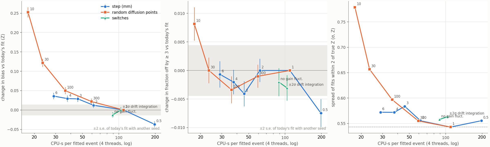
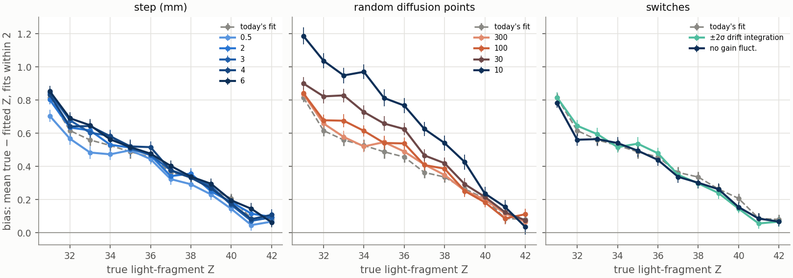
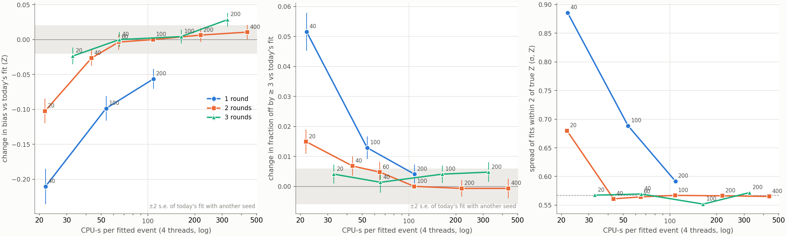
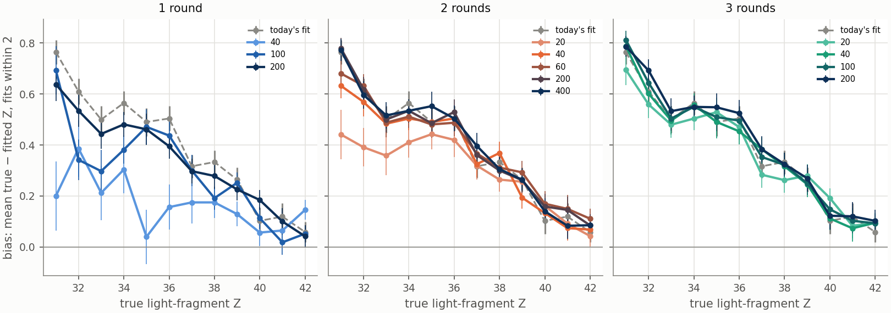
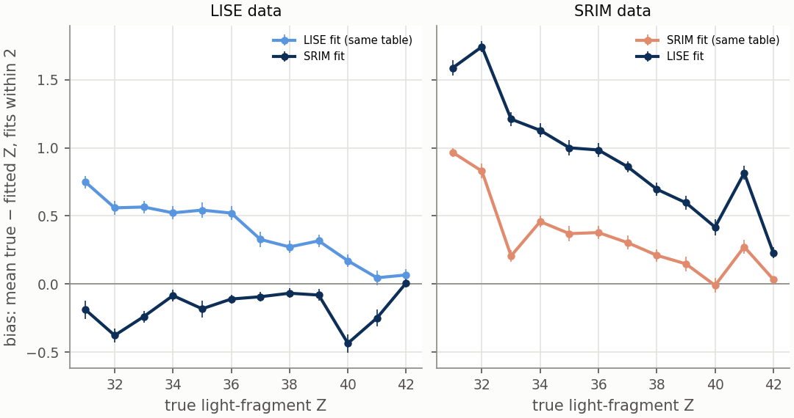

# MC Fit Tuning Study: Physics Against Cost

**Status (2026-10-19 07:00):** done: simulation detail, search length, decay angle, energy-loss tables. Running, expected about 09:00: the fixed diffusion pattern, the fit at the data's own level of detail, four-round searches. Combined settings follow. Decisions and events: [LOG.md](LOG.md).

The [fit speed study](../../../../docs/development/fit-speed-study.md) made the e12014 fission fit (`run_fit.C`) about 5 times cheaper at an arbitrarily chosen search of 100 iterations × 2 rounds. This study maps what the fit can do: how much cheaper the search and the fit's own simulation can be made, and what each change costs in physics. Today's settings are one point on that map, not a target.

## Summary

- **The fit only works near a 90° decay angle.** It assumes 90° in the center-of-mass frame. Within 15° of it, 4% of fits are off by 3 or more in Z; 15–30° off, 69% are, and 4 times more search changes none of that. The rest of the study uses 90° data.
- **At 90°, 95% of today's fits land within 2 of the true Z**, with a spread of 0.54 Z. The other 5% are off by 3 or more; 3% have the right pair of Z on the wrong tracks.
- **Those fits are biased by +0.40 Z toward asymmetric splits**, from +0.08 at a symmetric split to +0.82 at light Z = 31 (the fitted light fragment too light). The bias belongs to the fit: more search does not change it, of the simulation settings only a finer step moves it (−0.04 Z at 0.5 mm), and it remains when the fit uses the data's energy-loss table. Every setting with no measurable effect reproduces it within 0.03 Z.
- **Simulation detail.** A 2 mm step (1.8× cheaper), integrating ±2σ instead of ±3σ along the drift (1.06×) and no gain fluctuations (1.23×) change nothing measurable. Fewer random diffusion points add bias steadily: +0.02 Z at 300, +0.05 at 100, +0.25 at 10. A 0.5 mm step improves both bias and the rate of large misses, at 1.8× the cost.
- **Search length.** 100 iterations × 2 rounds has converged. 60 × 2 and 40 × 3 change nothing measurable at 1.65× cheaper; 20 × 3 (3.3× cheaper) is at the limit. Rounds pay more than iterations: 20 × 3 matches 60 × 2 with half the simulations. Too short a search gives more large misses and pulls fits toward the prior's center.
- **The energy-loss table matters more than any fit setting.** Fitting LISE data with SRIM tables, or the reverse, shifts the bias by about 0.6 Z, against at most 0.04 for any setting with no measurable effect; the rate of large misses does not change.
- **Today's search is visibly random.** Two seeds give a different fitted Z for 16% of 90° events, mostly among the large misses.

## How the fit searches

- **Only fragment Z is sampled.** `AtMCFission` takes the fragment directions and the vertex from the Y-pattern (zero spread). `thBeam` is sampled but unused.
- **The prior is a Cauchy**: a Student-t with 1 degree of freedom, centered at Zcn/2 = 42 with scale 3, rounded to an integer.
- **Rounds narrow it.** After each round the distribution is recentered on the best result so far and its scale halves: 3, 1.5, 0.75. At 0.75 almost every draw rounds to the current best Z.
- **The estimate is a minimum over noisy simulations.** Each iteration simulates the event with the sampled Z and computes a charge chi2 with a fitted amplitude; the fitted Z is that of the lowest chi2.
- **Cost.** Almost all of an iteration is `AtPulseLine::GenerateEvent`: per simulation step one charge line, a point charge at the step's midpoint, whose transverse diffusion is sampled with 1000 random points, then one gain draw and fill per pad and time bucket. About 70% of the cost scales with the number of lines (a 0.5 mm step costs 1.8×, not 2×), and about two thirds of it with the number of diffusion points.

## Method

### Simulated data

Each data set is made once and fit by every setting that uses it. 3000 events in 60 chunks of 50, LISE tables, 6 CPU-s/event digitization, 30 GB.

- **Flat in Z.** The heavy fragment's Z is drawn per event uniformly over 43–54 (light 42–31), one exact split per event (`sim.zToSimMax`, `sim.massDev = 0`), so every result comes per true Z.
- **More detailed than any fit.** 0.25 mm steps (`sim.step`) and 4000 diffusion points per line (`digi.intPoints`), so no fit setting matches the data's model exactly, as with real data.
- **Decay angle.** `tune_data90.ini`: fixed at 90°, the angle the fit assumes; used for every setting. `tune_data.ini`: sampled from the measured distribution, for the angle results.

### What is measured

Over **every fitted event**, from `tune_report.py --truth tune_study/truth_<data>.csv --unfolded --all`.

- **Error dZ** = true Z of the light fragment − the Z the fit gave that same fragment. Fitted fragments are matched to true ones by azimuth (true from each fragment's first MC point, `sim_truth.C`; fitted from `ph0`/`ph1` of the best result; median mismatch 0.007 rad; 2% of events have fragments too close in azimuth and are dropped). `plot_fit.C`'s dZ, the lighter true Z minus the lighter fitted Z, cannot tell when the fit puts the two Z on the wrong tracks, and near symmetric splits it can only err one way, since the lighter fitted Z cannot exceed 42.
- **Fits within 2 of the true Z, and large misses, separately.** Most fits land within 2 of the truth; a few miss widely. One mean and width over all of them describe neither group. **Bias** and **spread** are the mean and standard deviation of dZ over fits with |dZ| ≤ 2; **large misses** are fits with |dZ| ≥ 3, wrong-track fits included. Both per true Z and, for sampled angles, per |90° − θCM|.
- **Compared event by event with today's fit** on the same events: the change in bias (over events within 2 in both fits), the change in the rate of large misses, and one chi2 test of the bias changes over the 12 true-Z values ("per-Z p"). A second run of today's fit with another seed shows what chance alone does. Event-by-event errors are about 5 times smaller than those of comparing the two fits' totals.
- **Pass rate of `plot_fit.C`'s cuts** (0 < `EBeam` < 5000 MeV, 0 < `Amp` < 1, 0 < `ObjQ` < 1000, `ObjPos` < 100), as an efficiency only. The cuts select on the fit's own outputs, so selecting with them would measure a worse setting on a cleaner subset.
- **Cost:** CPU-s per fitted event (user + system, start-up included) at `fit.threads = 4`, the production setting. A job fits 50 events; today's fit takes 1210–1600 s of wall per job (median 1390 s, 28 s/event).

**No measurable effect.** A setting has no measurable effect when, against today's fit on the same events, all three hold:

1. **Bias:** the change is below 0.05 Z and within 2 standard errors of zero.
2. **Large misses:** the change is below 1 percentage point and within 2 standard errors of zero.
3. **Bias per Z:** the per-Z p is above 0.01, so a setting that harms only some splits is caught.

The 0.05 Z and 1-point floors let a real but negligible change pass. Otherwise the tables mark the setting as changing the results and name the test it fails. Today's fit rerun with another seed passes: bias change −0.007 ± 0.007, large-miss change −0.17 ± 0.22 points, per-Z p = 0.61. The measurement resolves bias changes of about 0.015 Z and large-miss changes of about half a percentage point.

### What was run

| Topic | Study file | What varies | Events |
|---|---|---|---|
| Simulation detail | `tune_fid90.ini` | at 100 × 2: step 0.5–6 mm; random diffusion points 300–10; fixed diffusion pattern 300–10 points; ±2σ drift integration; no gain fluctuations | 3000, 90° |
| Combined settings | (pending) | the cheapest setting with no measurable effect for each of the above together; then each one step further | 3000, 90° |
| Search length | `tune_iter90.ini` | iterations × rounds: 40, 100, 200 × 1; 20–400 × 2; 12–200 × 3; 12, 20 × 4; at today's simulation detail, then at the combined settings | 1500, 90° |
| Source of the bias | `tune_iter90.ini`, section `match` | the fit at the data's level of detail (0.25 mm, 4000 points) | 500, 90° |
| Decay angle | `tune_fid.ini` | 40 × 2, 400 × 2, 200 × 3 against 100 × 2 | 1500, sampled |
| Energy-loss tables | `tune_eloss90.ini` | LISE and SRIM data, each fit with LISE and SRIM | 1500 each, 90° |

## Results

### Decay angle

Today's fit (100 × 2) on sampled angles, every fitted event:

| \|90° − θCM\| | 0–15° | 15–30° | 30–45° | 45–60° | 60–90° |
|---|---|---|---|---|---|
| events | 510 | 571 | 625 | 729 | 500 |
| off by ≥ 3 | 4% | 69% | 86% | 71% | 85% |
| bias | +0.28 | −0.37 | +0.42 | +0.05 | −0.52 |
| pass `plot_fit.C`'s cuts | 96% | 92% | 87% | 35% | 0.4% |

- Beyond 15° from 90° most fits miss by 3 or more; over all angles 64.5% do, and 22% put the two Z on the wrong tracks. The biases off 90° come from the few events fit within 2.
- The cuts act mostly as an angle filter (`EBeam` and `Amp` reject the off-90° events), which hides how badly the fit does there.
- More search does not help off 90° (1500 of these events):

| search | speed | 0–15° | 15–30° | 30–45° | 45–60° | 60–90° |
|---|---|---|---|---|---|---|
| 100 × 2 (today) | 1.00 | 4% | 69% | 86% | 71% | 85% |
| 40 × 2 | 2.50 | 4% | 69% | 85% | 72% | 83% |
| 400 × 2 | 0.25 | 4% | 69% | 86% | 74% | 84% |
| 200 × 3 | 0.34 | 5% | 69% | 85% | 71% | 84% |

  Rates of fits off by 3 or more, per angle; every change from today's fit is within 2 standard errors. Off 90°, the fit's fixed 90° decay angle sets the outcome, not the length of the search.

### Today's fit at 90°

100 × 2 on `tune_data90.ini`, 2945 matched events, 108 CPU-s/event:

| fit | bias | spread | off by ≥ 3 | wrong tracks | exactly right | pass cuts |
|---|---|---|---|---|---|---|
| today's | +0.398 ± 0.010 | 0.54 | 4.8% | 3.0% | 54% | 95% |
| today's, another seed | +0.379 ± 0.011 | 0.56 | 4.7% | 3.0% | 55% | 95% |

| true light Z | 31 | 32 | 33 | 34 | 35 | 36 | 37 | 38 | 39 | 40 | 41 | 42 |
|---|---|---|---|---|---|---|---|---|---|---|---|---|
| bias | +0.82 | +0.62 | +0.56 | +0.53 | +0.49 | +0.46 | +0.36 | +0.34 | +0.26 | +0.21 | +0.09 | +0.08 |
| off by ≥ 3 | 6% | 6% | 9% | 4% | 5% | 4% | 4% | 3% | 7% | 4% | 5% | 2% |

- Two seeds give the same fitted Z for 84% of events; the events that differ are mostly large misses (RMS of the difference 1.38 Z).
- The large misses are almost exactly the events the cuts remove (of 214 failing a cut: `Amp` 203, `ObjPos` 199, `ObjQ` 159, `EBeam` 64, mostly the same events). Left in, they triple the overall σ (0.80 → 2.45) and pull the overall mean to +0.02, hiding the bias.
- The bias is positive (fitted light fragment too light, i.e. too asymmetric) and grows with asymmetry until nearly every Z = 31 event fits one Z too light. A longer search leaves it unchanged (100 × 2 to 400 × 2 and 200 × 3), and the step accounts for little of it (−0.04 Z at 0.5 mm). The fit at the data's own step and diffusion points measures how much the remaining difference in detail contributes.

### Simulation detail

Each setting alone at 100 × 2, all 3000 events at 90°, compared event by event with today's fit (108 CPU-s/event). "Speed" is today's CPU over the row's. Changes are row − today; a positive bias change is more bias.

| setting | speed | bias | spread | off by ≥ 3 | bias change | change off by ≥ 3 | per-Z p | effect |
|---|---|---|---|---|---|---|---|---|
| today's, another seed | 1.00 | +0.379 | 0.56 | 4.7% | −0.007 ± 0.007 | −0.17 ± 0.22 pts | 0.61 | none |
| step 0.5 mm | 0.55 | +0.353 | 0.56 | 4.1% | −0.037 ± 0.007 | −0.75 ± 0.24 pts | 0.0002 | better |
| step 2 mm | 1.77 | +0.406 | 0.56 | 4.8% | +0.012 ± 0.007 | +0.00 ± 0.20 pts | 0.65 | none |
| step 3 mm | 2.39 | +0.413 | 0.58 | 4.4% | +0.029 ± 0.008 | −0.41 ± 0.22 pts | 0.02 | more bias |
| step 4 mm | 2.92 | +0.420 | 0.57 | 4.6% | +0.029 ± 0.008 | −0.20 ± 0.21 pts | 0.002 | more bias, per Z |
| step 6 mm | 3.79 | +0.430 | 0.57 | 4.8% | +0.036 ± 0.008 | −0.07 ± 0.23 pts | 0.002 | more bias, per Z |
| 300 points | 1.84 | +0.416 | 0.56 | 4.7% | +0.022 ± 0.008 | −0.10 ± 0.20 pts | 0.19 | slightly more bias (2.9 s.e.) |
| 100 points | 3.04 | +0.440 | 0.60 | 4.5% | +0.050 ± 0.009 | −0.34 ± 0.24 pts | <10⁻⁶ | more bias |
| 30 points | 4.68 | +0.508 | 0.66 | 4.8% | +0.122 ± 0.011 | +0.00 ± 0.23 pts | <10⁻⁶ | more bias |
| 10 points | 6.18 | +0.639 | 0.78 | 5.6% | +0.252 ± 0.013 | +0.81 ± 0.29 pts | <10⁻⁶ | more bias, more misses |
| ±2σ drift integration | 1.06 | +0.392 | 0.56 | 4.5% | +0.000 ± 0.007 | −0.31 ± 0.22 pts | 0.09 | none |
| no gain fluctuations | 1.23 | +0.380 | 0.56 | 4.6% | −0.013 ± 0.007 | −0.20 ± 0.24 pts | 0.41 | none |
| fixed pattern 300–10 | | | | | | | | pending |

- **Step.** Coarser steps cost little: +0.03 Z of bias from 3 to 6 mm, concentrated in the asymmetric splits, and no change in large misses. A finer step is a measured improvement.
- **Diffusion points.** Fewer points steadily add bias, most for the asymmetric splits; large misses barely change down to 30 points. The likely mechanism is noisier charge spreads in the fit's simulation, picked out by the minimum chi2; the fixed pattern, with far less sampling noise per point, tests it.
- **Switches.** ±2σ drift integration saves 6%, no gain fluctuations 23%; neither changes the results.

### Search length

Iterations × rounds at today's simulation detail, the first 1500 events at 90°, compared event by event with 100 × 2 (108 CPU-s/event).

| search | simulations | speed | bias | spread | off by ≥ 3 | bias change | change off by ≥ 3 | per-Z p | effect |
|---|---|---|---|---|---|---|---|---|---|
| 100 × 2, another seed | 200 | 1.00 | +0.396 | 0.57 | 4.3% | +0.007 ± 0.010 | +0.34 ± 0.30 pts | 0.48 | none |
| 40 × 1 | 40 | 4.93 | +0.171 | 0.89 | 9.2% | −0.210 ± 0.025 | +5.2 ± 0.6 pts | <10⁻⁶ | changed |
| 100 × 1 | 100 | 2.01 | +0.297 | 0.69 | 5.3% | −0.099 ± 0.018 | +1.3 ± 0.4 pts | <10⁻⁵ | changed |
| 200 × 1 | 200 | 1.00 | +0.342 | 0.59 | 4.4% | −0.056 ± 0.014 | +0.4 ± 0.3 pts | 0.02 | changed (bias) |
| 20 × 2 | 40 | 4.97 | +0.302 | 0.68 | 5.5% | −0.103 ± 0.018 | +1.5 ± 0.4 pts | <10⁻⁴ | changed |
| 40 × 2 | 80 | 2.50 | +0.366 | 0.56 | 4.7% | −0.026 ± 0.011 | +0.7 ± 0.3 pts | 0.03 | changed (bias, misses; 2.1–2.3 s.e.) |
| 60 × 2 | 120 | 1.67 | +0.394 | 0.56 | 4.5% | −0.004 ± 0.011 | +0.5 ± 0.3 pts | 0.21 | none |
| 200 × 2 | 400 | 0.50 | +0.400 | 0.57 | 3.9% | +0.006 ± 0.010 | −0.1 ± 0.3 pts | 0.78 | none |
| 400 × 2 | 800 | 0.25 | +0.400 | 0.57 | 3.9% | +0.011 ± 0.010 | −0.1 ± 0.3 pts | 0.17 | none |
| 20 × 3 | 60 | 3.29 | +0.373 | 0.57 | 4.4% | −0.024 ± 0.012 | +0.4 ± 0.3 pts | 0.27 | none (1.98 s.e.) |
| 40 × 3 | 120 | 1.65 | +0.389 | 0.57 | 4.1% | +0.000 ± 0.011 | +0.1 ± 0.4 pts | 0.14 | none |
| 100 × 3 | 300 | 0.66 | +0.402 | 0.55 | 4.4% | +0.004 ± 0.010 | +0.4 ± 0.3 pts | 0.81 | none |
| 200 × 3 | 600 | 0.33 | +0.417 | 0.57 | 4.5% | +0.029 ± 0.010 | +0.5 ± 0.3 pts | 0.19 | changed (bias, 2.9 s.e.) |

- **100 × 2 has converged.** Doubling or quadrupling the iterations, or adding a round, changes nothing beyond 0.03 Z.
- **Too short a search pulls toward the prior.** One round, or two of 20, leaves fits near the prior's center (light Z 42): more large misses and a wider spread, and less bias for the asymmetric splits only because the pull cancels part of it (40 × 1: +0.20 at Z = 31 against +0.76).
- **Rounds are the cheap direction.** Each round halves the prior's scale around the best result so far; 20 × 3 matches 60 × 2 with half the simulations, and 40 × 3 equals 100 × 2. Four rounds: pending.
- **More search raises the bias slightly** (200 × 3: +0.029 ± 0.010), likely the minimum over more noisy simulations settling harder on the biased answer; the effect is at the edge of the statistics.

### Energy-loss tables

Two 90° data sets, made with the LISE and with the SRIM fragment tables (the beam uses LISE in both), each fit at 100 × 2 with each table; 1500 events per data set, compared event by event within a data set with the fit that uses the data's table.

| data | fit | bias | spread | off by ≥ 3 | exactly right | bias change | change off by ≥ 3 |
|---|---|---|---|---|---|---|---|
| LISE | LISE (same table) | +0.393 ± 0.015 | 0.57 | 4.0% | 54% | — | — |
| LISE | SRIM | −0.170 ± 0.014 | 0.54 | 4.4% | 69% | −0.565 ± 0.016 | +0.4 ± 0.3 pts |
| SRIM | SRIM (same table) | +0.346 ± 0.015 | 0.58 | 4.1% | 59% | — | — |
| SRIM | LISE | +0.937 ± 0.018 | 0.69 | 4.1% | 21% | +0.606 ± 0.016 | +0.0 ± 0.4 pts |

- **The fit's own bias does not come from the tables.** With the data's table, the bias is +0.35–0.40 with the same growth toward asymmetric splits.
- **The other table moves the bias by about 0.6 Z**, most for the asymmetric splits, and leaves the rate of large misses alone. The two directions are nearly symmetric (−0.57, +0.61). No pairing does better; LISE data fit with SRIM lands near zero bias (and 69% exactly right) only because the table difference cancels the fit's own bias.
- **For real data**, where the true stopping powers are unknown, the difference between tables limits the absolute Z accuracy to several tenths, ten times more than any setting with no measurable effect.
- **The SRIM curves are not smooth in Z.** Single-Z jumps (Z = 41 in the SRIM data, Z = 40 in the SRIM fit, Z = 33) appear only where a SRIM table is involved, beyond the statistical errors; the LISE/LISE curve is smooth. This points to irregularities between neighboring ions' SRIM tables; the tables themselves were not checked.

## Code and tools (branch `fit-tune`)

New settings default to the old behaviour, and with defaults the code path is the old code (a seeded fit with every new key at its default is identical to one without them).

- `AtPulseLine::SetUseFixedSample`: transverse diffusion sampled with one precomputed pattern of N points with the random points' distribution (radius |Gaus(0, σ)|, uniform angle: radii at the half-normal quantiles of (i + ½)/N on a golden-angle spiral), scaled by each line's σ and rotated randomly once per line, in place of N independent random points.
- The random points spread charge with radius |Gaus(0, σ)|, not as a 2D Gaussian with σ per axis (per-axis spread σ/√2). Every digitization path does the same and `CoefT` is set empirically, so the scale is absorbed in it; the pattern reproduces this distribution and is scaled by each line's σ like the random points, so it changes the sampling noise and, at small N, cuts the far tail (the widest of N points is at the (1 − ½N) quantile: 1.96σ at 10 points, 2.81σ at 100; mean r² 0.94 at 10 points, 0.994 at 100).
- `AtPulse::SetGainFluctuations(false)`: every deposit gets the mean gain.
- Settings `sim.step`, `sim.zToSimMax`, `sim.beamEloss`, `digi.intPoints`, `fit.step`, `fit.intPoints`, `fit.zSigma`, `fit.fixedPattern`, `fit.gainFluct` (see the manual).
- `tune_report.py` (tables), `tune_study/make_figures.py` (figures), `sim_truth.C` (true fragment azimuths; outputs in `tune_study/truth_*.csv`), `dump_fit.C` (per event: true and fitted Z, decay angle, fitted fragment azimuths).
- Unit tests for the pattern's moments and the mean gain.

## Appendix: machines and paths

- Branch `fit-tune` on `origin`. Cluster checkouts `/home/faculty/aanthony/fission/adam/tune/code` (remote `hpc-tune`) and `/home/faculty/aanthony/fission/adam/tune/code2` (`hpc-tune2`, for the energy-loss runs), sharing the data directory `/home/faculty/aanthony/fission/adam/tune/data`. `throttle.sh` and its log in `/home/faculty/aanthony/fission/adam/tune/`.
- Local worktree `.claude/worktrees/fit-tune`; fetched results in its `macro/e12014/fissionStudies/data/remote/hpc-tune/`.
- Section names in the study files and in `tune_report.py`'s output: `base`/`b100x2` today's fit, `base2`/`b100x2s` its reseed, `stepN`, `ptsN` (random points), `patN` (fixed pattern), `zs2`, `gain0`, `iNrM` (N iterations × M rounds), `match`, `lise_srim` (data table, fit table).
